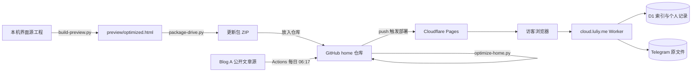

# LULIY 网站搭建、构建与维护指南

核对日期：2026-10-31。本文依据本地源码说明、`luliyer6-ux/home` 仓库现状、Cloudflare Pages 实际部署与线上检查整理。上一版（2026-10-19）的内容全部保留并补充；2026-10-24 新增：唱片与作品列表改为数据文件驱动，不再需要本机 `build-preview.py` 才能改列表（见 7.4 节）；2026-10-30 新增：站内加载页、首次访问开场视频、看板娘、评论区、短札、文章页背景等**直接在仓库里维护**的功能（见第 15 节）。

---

## 0. 一页速查

| 我要…… | 做法 | 详见 |
|---|---|---|
| 发一篇文章 | 在 Blog A（Gmeek）发布；想立即生成独立页就手动运行 Actions | 第 7 节 |
| 加一首公开歌曲 | 传 mp3 到 `music/`，或在 `data/songs.json` 里加一条（含 R2 直链）；推送后 Action 自动重生成 | 第 7.4 节 |
| 加一个作品 | 传 HTML 或文件夹到 `works/`，或在 `data/works.json` 里加一条；推送后 Action 自动登记 | 第 7.4 节 |
| 删一个作品或歌曲 | 只删文件不够，还要同步删 `data/works.json` / `data/songs.json` 里的条目 | 第 7.4 节 |
| 改首页界面 | 改本机源模块 → `build-preview.py` → `package-drive.py` → 放入 home 仓库 → `optimize-home.py` → 推分支看预览 → 合并 | 第 4、5、6 节 |
| 上线后自检 | 第 6.4 节的清单与命令 | 第 6 节 |
| 回退 | Git 回退提交，或在 Pages 部署历史里把旧部署设为正式 | 第 9 节 |
| 网盘出问题 | 查 Worker、会话、回调来源；与静态站无关 | 第 8、11 节 |
| 换电脑 | 带走源工程和**原始 HTML 快照**，修改快照路径 | 第 3、12 节 |
| 看开场视频 / 加载页 | 打开 `https://luliy.me/?intro=1`；`?loader=0` 跳过加载页（调试用） | 第 15.1 节 |
| 评论区没出现 | 检查 Giscus 配置与 Discussions 是否开启 | 第 15.3 节 |
| 文章页想默认带背景 | 改 `home-fixes.js` 第 24 段的 `DEFAULT_CHOICE` | 第 15.5 节 |

**三条铁律**

1. GitHub `home` 仓库里放的是**生成结果**，真正的源工程在本机。只改仓库里的 `index.html`，下次重建就会被覆盖。
2. 新的 `index.html` 放进仓库后，**必须**运行 `python3 site-publish/optimize-home.py`，否则首页会退回 2 MB 左右。
3. 推到 `main` 就会直接上线。日常改动先推到其他分支，在 Pages 预览网址确认后再合并。

---

## 1. 整体架构：四个相互独立的部分

| 部分 | 做什么 | 托管位置 | 数据来源 |
|---|---|---|---|
| 主站界面 `luliy.me` | 首页、书房、作品、文章、唱片、关于、Drive 入口与交互 | Cloudflare Pages，项目名 `home`，连接 GitHub `luliyer6-ux/home` 的 `main` 分支 | 本机生成的 HTML 与 assets |
| 公开文章发布 | 独立文章 `/articles/Pxx/`、RSS、站点地图、分享信息 | 同上，由 GitHub Actions 生成并提交 | Blog A 的公开 Gmeek 资料 |
| 私人网盘后台 `cloud.luliy.me` | Telegram 登录、文件索引、读写、收藏与个人收录 | 单独的 `tg-s3` Cloudflare Worker + D1 | 索引和记录在 D1，原文件在 Telegram |
| 外部站点 | Blog A `blog.luliy.me`、Blog B `mini.luliy.me`、部分作品页 | GitHub Pages、42web.io、`*.pages.dev` | 各自独立维护，本工程不负责重建 |

这不是“每增加一个 HTML 就租一台服务器”。Cloudflare Pages 托管静态文件，由 Cloudflare 的基础设施发送给浏览器；你没有维护任何 VPS。Worker 是单独的托管执行服务。GitHub 负责保存发布文件和版本记录。



公开网页、公开文章源和私人文件存储相互连接，但不能混在同一个文件夹里。

### 1.1 域名分工

| 地址 | 内容 | 托管 |
|---|---|---|
| `luliy.me` | 主站 | Cloudflare Pages（`home`） |
| `home-41t.pages.dev` | 同一项目的 Pages 地址；`<分支名>.home-41t.pages.dev` 是分支预览 | Cloudflare Pages |
| `cloud.luliy.me` | 私人网盘（后端 Worker：`tg-s3.luliyer6.workers.dev`） | Cloudflare Worker |
| `blog.luliy.me` | Blog A（Gmeek，仓库 `luliy6/luliy6.github.io`） | GitHub Pages |
| `mini.luliy.me` | Blog B | GitHub Pages |
| `luliy6.42web.io` | 部分作品页（CET4、Letter、408） | 42web.io 免费主机 |
| `22408-kaoyan-tools.pages.dev` | 22408 考研复习站 | Cloudflare Pages（独立项目） |

---

## 2. 前端是怎样做出来的

主站用 HTML、CSS 和 JavaScript 编写，不用 React、Vue 或 Next.js 之类的整站框架。

- **路由**：使用网址的哈希部分，例如 `#/posts`、`#/article/P54`、`#/books`、`#/music`、`#/drive`、`#/colophon`。切换栏目时，脚本只更新正文区域；导航、主题和共享播放器继续使用同一个页面环境，所以换栏目时音乐不会中断。路由的取舍见第 10 节。
- HTML 提供内容容器、导航、按钮、弹窗及可访问名称。
- CSS 控制七个主题（深色、浅色、cc，以及深色下的四套配色）、排版、响应式布局、焦点样式、照片光影与动画。
- JavaScript 管理路由、文章读取、目录、图箱、文件管理和播放队列。
- Canvas 与 Three.js（r185，本地打包，不依赖外部 CDN）用来绘制星空、月面、书房和唱片机。
- 音乐由**一个共享音频实例**驱动；小播放卡片和唱片页读取同一份状态，而不是各自播放一首歌。
- 文件阅读器和元数据解析组件（`assets/drive/`）按需加载，避免首次打开网站就下载全部组件或私人原文件。
- **繁简转换**：界面源文字为简体；需要繁体时，`craftsmanship` 脚本逐字查表转换，`optimize-home.py` 再补充几条词组修正（如 詞彙、乾淨、鍾情）。日文和英文界面使用各自的文案表。

**字体分工**：英文主要用 EB Garamond；中文、日文用系统衬线字体；签名用 Amalfi Coast；页名沿用现有的 Times New Roman 设置。各字体资源分别适用各自的授权条件。

**签名**不是播放视频：先从字体生成精确的字形 SVG，再准备书写轨迹；运行时用小画布逐笔描出轮廓，并缓存已经写完的字母。签名完成后，人物、门和楼梯在 y 的右下方柔和显现。开启“减少动态效果”时，直接展示完成状态。

**开场（`intro/intro.js`）**：照片墙加引言，访客点击“進入”后进入首页。

- 照片墙使用 `assets/site/prologue/` 里的 420px WebP 缩略图（共约 0.36 MB）。
- 回访访客 7 天内跳过开场；网址加 `?intro=1` 强制显示，加 `?intro=0` 强制跳过。
- 开启“减少动态效果”时不播放开场。

---

## 3. 源文件与生成结果

### 3.1 本机源工程（不在 GitHub 上）

下列路径相对于本机工程根目录。

| 文件或目录 | 用途 |
|---|---|
| `build-preview.py` | 主站生成入口，依次执行各源模块的处理 |
| `ds-v2.css`、`polish-preview.py` | 基础设计与主要界面调整 |
| `patch-galaxy.py` | 星空等视觉效果的生成处理 |
| `reader-experience.py` | 文章阅读和唱片展示 |
| `media-integration.py` | Drive、图箱、书房、唱片之间的联动 |
| `music-player.py` | 统一音乐队列和小播放卡片 |
| `site-release.py` | 发布前处理：文本、静态资源、签名、网站说明 |
| `site-colophon.js`、`site-colophon.css` | 网站说明页的内容与布局 |
| `home-signature.*`、`footer-signature.*` | 首页、页尾签名的状态和样式 |
| `signature-renderer.*`、`signature-strokes.json` | 逐笔绘制、装饰位置及预先生成的轨迹数据 |
| `brand-fonts/` | 构建时需要的字体源文件 |
| `luliy-drive*.js`、`luliy-media-library.js` | Drive、阅读器、缩略图与个人媒体联动 |
| `site-publish/generate.py` | 独立公开文章、RSS、索引的生成入口（也随 home 仓库发布） |
| `package-drive.py` | 打包正式静态发布文件，排除后台凭据 |
| `qa-*.cjs` | 浏览器验收脚本（含本机浏览器路径，换电脑需调整） |
| `tg-s3/src/`、`tg-s3/migrations/` | 私人网盘后端源码与数据库迁移，与静态主站分开 |

**本机依赖警告**：`build-preview.py` 会读取一份原始 HTML 快照，它的路径写死在脚本里，而且位于工程目录之外。换电脑时，必须带上这份快照并修改路径，或者先把它移进源工程。只下载线上 home 仓库，**不等于**拿到了完整的主站设计工程。

### 3.2 生成结果（`preview/`）

```text
preview/
  optimized.html             主站本地预览；打包后改名为 index.html
  assets/site/               图片、字体与分享图（文件名为内容摘要）
  assets/drive/              文档阅读、媒体解析等组件
  articles/P54/index.html    公开独立文章示例
  site-publish/              文章生成脚本和轻量样式
  .github/workflows/         公开文章的自动更新流程
  feed.xml / sitemap.xml / robots.txt / public-articles.json
  _headers                   静态资源缓存设置
  LULIY-建站与维护指南.md      本说明的下载文件
```

### 3.3 线上仓库 `luliyer6-ux/home`（Pages 直接发布这里的文件）

```text
index.html                   首页（经 optimize-home.py 处理后约 154 KB）
404.html                     不存在的地址显示这一页（返回 404）
favicon.ico                  网站图标
_headers                     缓存与安全响应头
_redirects                   重定向与改写规则
assets/site/                 指纹图片与字体，长期缓存
assets/site/home/            optimize-home.py 从首页拆出的 JS/CSS（内容哈希命名）
assets/site/prologue/        开场照片墙缩略图
assets/drive/                Drive 阅读与解析组件
intro/                       开场脚本、视频与海报
articles/Pxx/                独立文章静态页（Actions 生成）
mirror/                      博客文章列表与文章页的备份副本（Actions 生成，供 /gh/ 中转兜底，见 9.4）
functions/gh/[[path]].js     GitHub 内容中转（Pages Functions，地址 /gh/*，见 9.4）
site-publish/                generate.py、optimize-home.py、article.css、home-fixes.css/js、home-early.js、design-tokens.*、runtime-fixes.py、brand.py、brand/、pwa.py、sw.js、pwa/
sw.js / manifest.webmanifest  由 pwa.py 从 site-publish/ 复制，不要手改
study/                       考研进度子应用（有自己的 _headers）
works/                       作品子应用：408、英语二、数学、静钟（jingzhong）、考研看板等；顶层新 HTML 或文件夹会被 7.4 的流程自动登记为草稿作品
data/                         唱片与作品列表的数据源：`songs.json`（18 首，2026-10-24）、`works.json`（11 个，2026-10-24）
music/                        新音频文件放这里会被自动登记为草稿歌曲（见 7.4）
feed.xml / sitemap.xml / robots.txt / public-articles.json
.github/workflows/public-articles.yml、.github/workflows/build-lists.yml（唱片与作品列表重生成，见 7.4）
*.md                         各类说明文档（会被公开发布，可直接下载）
```

仓库根目录下的 `.md` 文件都能通过网址直接下载。不要在里面写任何密钥、Token 或私人信息。

---

## 4. 主站界面的完整构建流程（本机）

### 第一步：准备输入

准备好以下内容：原始 HTML 快照、各源模块、图片和字体、`assets/drive` 组件，以及已有的公开文章发布文件。

- Python 构建入口用 Pillow 处理图片。
- 浏览器验收另外使用 Playwright 和 Chrome；访客访问网站不需要安装这些工具。

不要把 `.env`、机器人 Token、Login Client Secret、Cloudflare 令牌或 `node_modules` 放进公开静态目录。网站只读取后台接口，不需要带着后台密钥访问。

### 第二步：修改对应的源模块

例如：改网站说明就改 `site-colophon.js`；改音乐队列就改播放器相关模块；改签名样式就改签名源文件。

**不要只改生成后的 `preview/optimized.html`**，下次重建会把它覆盖，修改就丢了。

### 第三步：执行主站生成

在工程根目录执行：

```powershell
python build-preview.py
```

处理顺序：原始 HTML → 图片压缩及基础样式 → 星空 → 界面整理 → 阅读体验 → 媒体联动 → 音乐播放器 → 发布处理。

`site-release.py` 会把部分内嵌的图片和字体拆成 `assets/site/` 下的文件，以内容摘要命名：内容相同就复用同一个文件名，内容变了就生成新文件名，方便浏览器识别更新。

不要对同一个生成文件反复单独运行各个补丁脚本：其中一些步骤按固定输入做替换，不能无限重复执行。正常更新时，从 `build-preview.py` 重新开始。

### 第四步：本机查看

可以直接打开 `preview/optimized.html` 看基本布局。更接近线上环境的做法是：

```powershell
python -m http.server 8080 --directory preview
```

然后打开 `http://localhost:8080/optimized.html#/colophon`。这只是本机的临时预览服务，关闭终端就停止。需要正式 HTTPS 来源的 Telegram 授权流程，要在正式网站上验证。

### 第五步：验收

- **界面**：桌面、手机、七个主题、键盘操作、减少动态效果、路由返回，以及图片和字体是否缺失。
- **音乐**：播放、切歌、列表，以及跨栏目连续播放。
- **Drive**：登录前为空、退出后清理、文件大小限制、预览出错时的提示。

本地工程已有 `qa-home-signature.cjs`、`qa-footer-signature.cjs`、`qa-site-release.cjs` 等检查工具，里面写着当前电脑的浏览器路径，换电脑要先调整。要分清“文章源网络故障”和“界面逻辑错误”，不能把缺失的网络内容当成通过验证。

### 第六步：打包

```powershell
python package-drive.py
```

得到 `LuliyDrive-更新包.zip`。打包时会把预览 HTML 改名为 `index.html`，同时带上资源、公开文章、自动更新脚本、索引和说明；`manifest.json` 保存文件摘要和发布标记。

打包脚本会读取本机的后端配置，检查有没有意外混入敏感值，但不会把配置文件放进 ZIP。换电脑时如果没有这份配置文件，要先调整打包检查的输入；不要为了能打包，就把密钥复制到静态网页里。

---

## 5. 首页优化：`site-publish/optimize-home.py`

生成出来的 `index.html` 把全部脚本和样式都内嵌在一个文件里，约 2 MB；Three.js、书房代码和繁简表就占了一大半。HTML 本身不能长期缓存（每次访问都要重新验证），所以老访客每次都要重新下载约 570 KB（压缩后）。

`optimize-home.py` 是**放进仓库之后**的后处理，作用如下：

1. **拆分大块内嵌资源**：`<body>` 里超过 4 KB 的内嵌脚本和主样式表（`#site-styles`）会移到 `assets/site/home/<内容哈希>.js/.css`，原位置换成外部引用，**执行顺序不变**。`<head>` 里的脚本保持内嵌，避免拖慢首屏。CSS 里的相对路径 `url(assets/...)` 会自动改成 `/assets/...`。
2. **长期缓存**：`assets/site/*` 由 `_headers` 设置为一年缓存且内容不变（immutable）。文件名就是内容哈希，内容一变文件名就变，不会读到旧缓存。
3. **注入修复文件**：在 `</head>` 前加入 `site-publish/home-fixes.css`，在 `</body>` 前加入 `home-fixes.js`（`async`，不排在大脚本后面），把 `home-early.js` 内联到 `<head>` 最前面。见下方 5.2。
4. **繁简修正**：钟→鐘，补上 着→著，并修正 詞彙、字彙、語彙、乾淨、乾燥、餅乾、鍾情、鍾愛 等词组。
5. **开场脚本版本号**：按 `intro/intro.js` 的内容自动更新 `?v=`。
6. **设计变量（颜色、动效、字体）**：最后运行 `site-publish/design-tokens.py`（也可单独运行）。见下方 5.1。
7. **运行时修正（性能、无障碍）**：再运行 `site-publish/runtime-fixes.py`（也可单独运行）。见下方 5.3。
8. **品牌图标**：运行 `site-publish/brand.py`，把顶栏的 L 换成 `site-publish/brand/` 里的图标。见下方 5.5。
9. **离线阅读与添加到主屏幕**：最后运行 `site-publish/pwa.py`。见下方 5.4。

用法：

```bash
python3 site-publish/optimize-home.py
```

- **可以重复运行**：已经处理过的首页会显示“already optimized”，仍被引用的文件不会被删除，不再引用的旧文件会被清理。
- 如果提示 `patch skipped (not found)`，说明源工程里对应的代码变了，替换规则需要更新；首页仍然能正常工作，只是那条修正没有生效。
- 实测效果（2026-10-19，桌面）：首页 HTML 压缩后从 572 KB 降到 54 KB；首次访问总传输从 3.67 MB 降到 2.33 MB；再次访问从 572 KB 降到约 54 KB。

建议以后把这一步并入本机的 `build-preview.py` 或 `package-drive.py`，从源头上避免漏跑。

### 5.1 设计变量：`site-publish/design-tokens.css`

三套外观（深色 dark / 浅色 light / cc）和深色的四套配色的界面颜色、全站动效和字体**只在这一个文件里定义**。颜色每套 10 个：

| 变量 | 用途 | 深色 | 浅色 | cc |
|---|---|---|---|---|
| `--bg` | 页面底色 | #111110 | #faf9f5 | #111222 |
| `--paper` | 卡片、面板 | #191918 | #f0eee7 | #1a1a31 |
| `--raised` | 弹层、浮层 | #222220 | #e9e6dd | #24243f |
| `--ink` | 标题、最深的字 | #f2ede4 | #141413 | #eadfbe |
| `--text` | 正文 | #e8e3d9 | #30302d | #d5c8a5 |
| `--muted` | 次要文字 | #a6a198 | #66645e | #b3a487 |
| `--line` | 分隔线 | #3b3935 | #d8d5cd | #3a3955 |
| `--line-strong` | 按钮、输入框边框 | #777168 | #918b80 | #6a6688 |
| `--accent` | 唯一强调色（金） | #b89a6a | #8b6840 | #d2b878 |
| `--focus-ring` | 键盘焦点框 | #b89a6a | #9b4a32 | #e9ad88 |

cc 外观的底色是一道靛蓝夜空渐变（参考 GTA VI 官网）：`--day-gradient` = `linear-gradient(189deg, #1f1f38 → #18182d → #111222 → #0c0d1b)`，定义在 `home-fixes.css`，所有设备一致。页面底和页脚幕布都用它（cc 原有的 7px 画框 `.cc-frame` 已取消，见 5.2“cc 画框与文章”）；上表 cc 列的卡片、分隔线颜色随之改为同一色系的靛蓝，文字和金色不变。触屏上 iOS 不支持 `background-attachment: fixed`，由 `runtime-fixes.py` 在 `.page-above` 里加一层 `.luliy-sky`（裁在页面内的固定层）保持一屏大小；浏览器地址栏颜色（`theme-color`）在 cc 下为 `#1f1f38`（`home-fixes.js` 第 12 段）。

**深色的四套配色**：`<html data-palette="forest|espresso|midnight|oxblood">` 叠在深色外观（`data-appearance="dark"`）上，只换底色、卡片、分隔线和次要文字，正文、标题、金色不变；页面底、目录、页脚幕布也和 cc 一样改成同色系的一道夜空渐变（`--luliy-sky`，`home-fixes.css`）。选择记在 `localStorage` 的 `luliy-palette`，`home-early.js` 在 `<head>` 最前面就写上，刷新不闪；选回其他主题时删除。

| 配色 | `--bg` | `--paper` | `--raised` | `--muted` | `--line` | `--line-strong` | 夜空渐变（上 → 下） |
|---|---|---|---|---|---|---|---|
| 墨綠 forest | #111a17 | #16211d | #1e2b26 | #a3a99f | #2c3b35 | #5a6b63 | #1d2a25 → #17221e → #111a17 → #0b110f |
| 暖墨 espresso | #181411 | #1f1a16 | #29231e | #aaa194 | #3d352d | #706455 | #2a231d → #211c17 → #181411 → #0f0d0b |
| 夜藍 midnight | #111319 | #171a21 | #20242d | #a3a3a6 | #2e323d | #5c6170 | #1d212b → #171a22 → #111319 → #0a0b0f |
| 酒紅 oxblood | #190e10 | #211315 | #2b1a1d | #ad9f9c | #42292d | #76565b | #2b181b → #221316 → #190e10 → #10090a |

地址栏颜色取渐变最上面一色（第 12 段）。书房 3D 场景（#070707）和唱机的进度轨保持中性，属于场景设计。

动效 3 条曲线、3 档时长（`linear` 照旧用于旋转、进度和循环）：

| 变量 | 值 | 用途 |
|---|---|---|
| `--ease` | cubic-bezier(.19,1,.22,1) | 主曲线：出现、展开、移动 |
| `--ease-soft` | cubic-bezier(.22,.61,.36,1) | 小变化：悬停、颜色、透明度 |
| `--ease-in-out` | cubic-bezier(.65,0,.35,1) | 往返、循环、离场 |
| `--dur-fast` | 200ms | 悬停、按下 |
| `--dur-base` | 400ms | 面板、菜单、卡片 |
| `--dur-slow` | 800ms | 大块出现、场景切换 |

字体 5 个角色（中文一律回退到仓耳楷体 `Luliy Canger Kai`）：

| 变量 | 字体 | 用途 |
|---|---|---|
| `--font-body` | Anthropic Preview Serif | 正文，也是全站默认字体 |
| `--font-ui` | Anthropic Preview Sans | 按钮、日期、文章信息、阅读设置 |
| `--font-display` | Times New Roman（+宋体） | 编号、年份、文章列表标题、大号斜体标题 |
| `--font-script` | Amalfi Coast | 签名 Luliy |
| `--font-mono` | Luliy Anthropic Mono | 代码 |

- 唱片封面和星系标签上的 Georgia 小字、canvas 绘制的文字、开场 `intro.js` 保留原写法，属于封面和场景设计的一部分。
- `design-tokens.py` 按 `FAMILY` 表把写死的字体列表换成变量，旧变量 `--site-body-font`、`--site-ui-font`、`--site-heading-font`、`--site-code-font` 一并收拢；一直被覆盖、从没显示出来的写法（思源黑体、SimSun、system-ui）直接删除。`@font-face` 不动。

- 过渡时长按就近归档：<283ms→fast，<566ms→base，≤1100ms→slow；更长的（开场、月亮、幕布）和关键帧动画时长、延迟都保留原值。系统开启“减弱动态效果”时三档都变成 1ms。
- 脚本里的 Web Animations（`easing:'…'`）不能用变量，脚本会写入对应曲线的字面值。
- 改颜色、动效或字体：只改 `design-tokens.css`，然后运行 `python3 site-publish/optimize-home.py`（或 `python3 site-publish/design-tokens.py`）。
- `design-tokens.py` 会把旧变量名改成上面的 10 个（颜色：`--gold`→`--accent`，`--lr-*`、`--ld-*`、`--sp-*`、`--surface-*`、`--text-*`、`--border-*`、`--control-line`、`--reading-accent`、`--rt-accent`、`--reader-heading-color` 等；动效：`--ease-out`、`--ease-settle`、`--ease-spring`、`--ui-ease`、`--luliy-ui-*`、`--dur-instant`、`--t-ui` 等），删除其他地方对这些颜色的定义，把文件内嵌为 `<style id="design-tokens">`，并给改动过的缓存文件换新哈希名。可重复运行。
- 源工程重建后旧变量名会回来，跑一遍 `optimize-home.py` 即可重新收拢；长期仍建议在本机源模块里直接改用这些变量。
- `--reader-body-color` 保留：阅读设置会把用户选的正文颜色写在 `<html>` 上，默认值是 `--text`。
- 场景专用颜色不进这张表：卡片烫金 `--foil-*`、首页签名金 `--signature-gold-*`、唱片封面插画、唱机材质。

另有 3 个辅助变量：

| 变量 | 值 | 用途 |
|---|---|---|
| `--accent-soft` | 强调色 14%（浅色 10%）的淡底 | 选中行、标签、焦点底色 |
| `--shell-max` | 1120px | 页面主栏宽度（与 `.shell` 一致） |
| `--prose-max` | 740px | 阅读栏宽度（与 `.source-body` 一致） |

间距 `--space-1`…`--space-10`（4–128px）和字号 `--step--2`…`--step-6` 已在主样式的 ds-v2 层里，直接用，不要再加第二套。

### 5.2 首页细节：`home-fixes.css` / `home-fixes.js`

| 效果 | 做法 |
|---|---|
| 页面切换 | 旧页上浮 2.5% 并淡出（400ms），新页淡入（450ms）；书房保留自己的交叉淡入，顶栏和文章标题的过渡不变 |
| 首页题词逐字出现 | 每字间隔 26ms，逗号句号后停 105ms，换行停 300ms，每字 1150ms，从 16% 亮度浮起；只在第一次打开首页、中文或日文时生效；读屏软件读整句 |
| 悬停时其他卡片退后 | 文章列表、首页项目展、关于页链接：悬停一张，其余降到 55%；只对鼠标和触控板生效 |
| 页脚月亮休眠 | 页脚还远在一屏以外时隐藏月亮画布，WebGL 停止绘制；滚到底前约半屏重新出现 |
| 被盖住的页脚不可聚焦 | 页脚完全被盖住时设为 `inert`，按 Tab 不会跳进看不见的链接 |
| 主题选择 | 目录里的主题按钮不再依次切换，而是弹出一张小卡片，七个圆形色样：暗黑、白天、CC、墨綠、暖墨、夜藍、酒紅（日文、英文各有译名），下方显示名称。点一下立即换上、卡片不关，方便对比；点外面、按 Esc 或再点主题按钮关闭，方向键可移动焦点。换主题时整页 400ms 交叉淡入（View Transition，`data-vt-dir=theme`）。`<dialog>` 实现，卡片停在按钮上方（放不下时在下方）；接口 `window.LuliyThemePicker(btn)`、`window.LuliySetAppearance(name)`（第 14 段） |
| cc 开场 | 从签名、月亮到书房原来要滚约 7 屏（电脑 6000px），中间约一屏半没有变化，而且月亮的入场动画一直把透明度锁在 1，不会按设计淡出。现在开场区缩到 `max(420svh, 3600px)`（≤700px：`max(380svh, 3000px)`），各段按比例提前（见 5.3），月亮的入场动画改为 `animation-fill-mode: backwards`，淡出后正好接上书房：电脑约 2.5 屏、手机约 2.2 屏到书房。减少动态效果时不变 |

系统开启“减弱动态效果”时，切换、逐字出现和退后的过渡都关闭。

**手机端：文章优先**（`home-early.js` 内联在 `<head>` 最前面，先于 `intro.js` 和路由运行）

| 效果 | 做法 |
|---|---|
| 打开即文章列表 | 手机（触屏且屏幕短边 < 600px）打开 `luliy.me/` 时直接换成 `#/posts`；分享出去的具体链接不受影响 |
| 不再遮罩等待 | 手机上把序幕记为“已看过”，文章不再被“正在载入”遮罩挡到全部资源加载完 |
| 完整首页仍在 | 目录 → Other → 首頁，或点按目录左上角的 ULIY；网址加 `?home` 或 `?intro=1` 也会打开完整首页 |
| 顶栏 L 图标 | 手机上（关于页除外）点按指向文章列表，长按约 0.5 秒在新标签页打开博客 GitHub Issues（见 5.5） |
| 滚动时收起控件 | 所有页面向下滑时顶栏淡出（文章页连同目录、回到顶部两个按钮）；往上滑、回到顶部附近或接近文末时出现。顶栏离开页顶后带一层底色渐变（`#header.luliy-washed::before`，向下延伸 24px 渐隐），不压字（`home-fixes.js` 第 4 段） |
| 本节链接按钮 | 触屏上点击区域加大到约 30×42，图标大小不变 |
| 开场画面 | 只在手机、每次会话第一次打开时出现：按当前外观（含深色的四套配色）的底色，品牌图标（沉思人像）的细线轮廓缓慢呼吸，最大的四块轮廓上有光绕行；页面渲染好就淡出（至少 0.7 秒、最多 1.5 秒）。`sessionStorage` 的 `luliy-loader-seen` 记录本次已看过，刷新不再出现；`?intro=1` 时让给完整序幕。电脑端不显示 |

判断手机用屏幕尺寸而不是视口：`<head>` 最前面运行时，视口标签还没解析，手机报告的宽度是 980px。

**手机端：轻一点的阅读界面**

| 效果 | 做法 |
|---|---|
| 文章头一行 | `← 日期 · 字数 · 阅读时间 …… 分享`，12px 灰字；分类、刷新、博客原文在手机上隐藏（仍在页面里，电脑端不变） |
| 宽图通栏 | 正文里单独成段、已占满正文宽度、原图不小于正文宽的图片，左右贴到屏幕边（`.luliy-bleed`，≤700px）；小图、行内图标、列表或引用里的图、特别长的截图不动 |
| 页脚变短 | `--footer-h` 在 ≤700px 从 480px 改为 `min(380px, 85svh)`；`.page-above` 的下边距用同一个变量，两者始终一致。文章页的页脚小字右侧让出浮动按钮的位置 |
| 列表封面 | 每篇封面要先下载文章页才能找到第一张图：现在把结果记在 `localStorage`（`luliy-cover-v1:*`，30 天），再次打开立刻显示、后台照常核对；文章页改为 `no-cache`（服务器没改时只回 304）。封面出现时淡入 |
| Three.js 延后 | 见 5.3：手机不在首屏下载 190 KB 的 Three.js |

**手机端：第三批界面调整**

| 页面 | 做法 |
|---|---|
| 文章列表 | 「文章 / 編年史」移进顶栏做成两个标签（`home-fixes.js` 第 9 段）；年份和「筛选」在同一行；筛选改为从底部升起的面板，「全部文章 · 23 篇」等计数放在面板里，可点 ×、点外面、按 Esc 或下滑关闭；有筛选条件时按钮带一个小圆点 |
| 作品 | 卡片改为两列 |
| 唱片 | 唱机下方的视图按钮（弹出、缩放、复位等）收进 ⋯ 面板（第 10 段）；正在播放区改成网格：封面、曲名、进度一行，上一首 / 播放 / 下一首三键一组；歌单按钮移到播放键组之后（宽屏移回原位）。播放控件仍是唱机监视的那个元素，进度和迷你唱机不受影响 |
| 目录 | 目录按钮改成两条粗横线 `=`（比例参照 GTA VI 官网：方头，线粗约为宽度的 1/5，间距与线粗相同），打开目录时两条线先合成一条，再各转 45° 变成同样粗细的 ×（合拢用 `transform`，旋转用单独的 `rotate` 属性，各有各的时间，交叉点始终在正中），圆形底同时淡入，关闭时倒着走一遍（`home-fixes.js` 第 13 段：目录打开的同一帧就会加上 `icon-open`，所以等 `=` 画出来后再加 `luliy-x` 触发过渡）。所有外观、所有设备都一样；当前页面在目录里高亮（`data-luliy-here`，跟随网址而不是鼠标预览）；左上角键盘焦点框收在 ULIY 外沿 |
| cc 目录 | cc 外观也用默认的全屏目录（人像、五个场景链接、底部语言和主题按钮），和其他外观一致；原来 cc 专用的右侧抽屉已移除。电脑端同样 |
| cc 画框与文字 | cc 原有的 7px 画框（`.cc-frame`）不再显示。cc 全站文字不再随滚动逐字由暗变亮，始终常亮（`runtime-fixes.py`「cc: text stays lit」）；首页题词在第一次打开时的逐字浮现（所有主题）不受影响。电脑端同样 |
| 目录预览区 | 所有外观、所有设备：图片下方那行小字（THE STUDY · 01 / 05 …）已删除；「關於」人像换成同一张照片的透明抠图（`assets/site/813c3f14546d3ff6cdb6.webp`，灰度 710×960），每个外观透出自己的底色，暗黑仍是黑底；人像改为绝对定位（原先作为网格项，百分比高度在 iPhone Safari 上算得不同，人像又小又偏下），手机端从顶部显示头肩、底部渐隐，电脑端保持原来的取景；旁边竖排题字的描边跟随文字颜色，浅色外观也看得清。「作品」预览只列最新的四个作品（列表末尾是最新加入的，倒序显示），电脑端字号略小，最长的名称也放得下。Other 菜单里「RSS 訂閱」恢复显示（原先和 ↗ 一起被隐藏，只剩空行），末尾多余的分隔线去掉 |
| 動態效果开关 | 关掉后在 `localStorage` 记 `luliy-motion=off`，`<html>` 加 `luliy-calm`；`home-early.js` 包一层 `matchMedia`，让星系、唱机等脚本按“减弱动态效果”处理，CSS 用 `html.luliy-calm` 关闭过渡；脚本接口 `window.LuliyMotion`（`calm`、`set()`，变化时发 `luliy:motion` 事件）。开关只在已关闭动效时出现在目录里（所有外观一样，第 11 段），方便重新打开 |

**手机端：第四批界面调整**（2026-10-24）

| 页面 | 做法 |
|---|---|
| 作品 | 顶栏正中换成「網頁 · 真題區 · 照片牆」三个标签（样式同文章列表的标签）。点按平滑滚到该区，区块顶端停在顶栏下方，滚动期间顶栏不收起；滚动时当前区的标签高亮（`aria-current`）；底部「我的空間」不单设标签，照片牆保持高亮（`home-fixes.js` 第 17 段） |
| 书房 | 3D 房间铺满整屏，不再有上下色带；顶栏透明，只留 L 图标、正中的「···」和目录按钮。房间原来的「··· 書房」按钮隐藏但仍负责开关，工具改从顶栏下落下，点外面、选工具（「更多」除外）、Esc、安卓返回都会收起（第 18 段）。音乐控件浮在底部，颜色、左右 10px 边距和圆角与全站播放条一致，让开 iPhone 底部横条；进度和音量线按当前值填色（`--fill`，见 5.3）。cc 外观的房间画的是白天，书房顶栏图标改用深色 `#2b2a40` |
| 唱片：封面轮播 | 手机上显示 5 张（当前左右各两张，原来各一张，见 5.3）。正中一张大小不变（390px 宽时 140px），两侧依次约 115px、92px，比原来露出更多；不在正中的封面不显示曲名 |
| 唱片：定时停止 | ≤700px 只留一个时钟图标（44×44，在「上一首」下面），原选单透明地盖在图标上（16px 字，iOS 不放大）。计时中图标变强调色，旁边小圆标显示剩余分钟（「播完本首」显示 ♪）。引擎不公开计时，圆标从选择那一刻开始算（重绘后读状态行里的数字），每 2 秒核对一次选单，计时结束时引擎把它归 0，圆标随之消失。电脑端不显示圆标（第 19 段） |
| 唱片：唱片布 | 唱片页顶栏正中多一个「唱片 ⌄」（日文レコード、英文 Records，`aria-expanded` / `aria-controls`）。点按后从顶栏下放下一块布：主题色（`--raised` 84% + `--accent`），带织纹和褶皱，波浪形下摆轻轻摆动；顶部写「全部唱片 · 18」，所有唱片像书房中间抽屉里那样排成黑胶（纹路、封面作中心标签、中心孔），手机 3 列，≥480px 4 列、≥600px 5 列、≥720px 6 列，横屏矮屏 8 列。正在放的一张带强调色光圈，播放时慢慢转。点一张直接播放（同点唱片架，`LuliyRecords.play`；同一张暂停时继续）并收起；再点「唱片」、上滑、点外面、Esc、安卓返回或换页都会收起。打开时页面不滚动、顶栏不隐藏；减弱动态效果时只淡入淡出。电脑端没有这个按钮（第 19 段 + `home-fixes.css`「Phones, records page」） |
| 目录 | Other 菜单「RSS 訂閱」后面加「Issues」，新标签页打开博客 GitHub Issues（电脑端同样） |
| 全站没有 ↗ | 链接后的 ↗ 一律去掉：文章页「在主站閱讀」、收藏预览「进入…」，以及作品（408、英语、数学、考研看板等）和学习页里的链接与按钮（电脑端同样）；数学手册里用作图标的 ↗️ 换成 🔄，只剩箭头的分支链接改写成「详情」。第三方库和文章 P28 的代码示例原样保留 |

**触屏设备：兼容性**

| 问题 | 做法 |
|---|---|
| 刘海、圆角（横屏最明显） | 页面已用 `viewport-fit=cover`；`.page-above`、顶栏、页脚内容、浮动按钮和迷你唱机按 `env(safe-area-inset-*)` 让开；竖屏没有左右安全区，布局不变 |
| 横屏手机页脚放不下 | 矮屏（触屏且高度 ≤500px）签名缩到 62%，邮箱 20px，间距收紧，整块页脚能在一屏里看全 |
| 滚动时毛玻璃掉帧 | 触屏上顶栏底板、目录 / 回顶按钮、迷你唱机、书房遮罩去掉 `backdrop-filter`，改成接近不透明的底色 |
| 点按灰块 | 去掉 iOS 点按高亮，改为按下时 60% 透明；落款长按和唱机控件保留各自反馈 |
| 输入框被放大 | iOS 会把小于 16px 的输入框整页放大（文章目录搜索框原为 14px）；触屏上输入框至少 16px |
| 省流量模式 | `home-early.js` 检测 Save-Data 后给 `<html>` 加 `luliy-save-data`：不显示页脚大图、列表不加载封面原图、不在空闲时预载目录图和 Three.js |
| 目录大图 | 目录里的书架照片、三张阅读人像、项目人像（合计约 5 MB PNG）原来每次打开任何页面都下载。现在改为目录将要打开时（按下目录按钮 / 打开时）才加载；电脑端在页面空闲后预载 |
| 安卓返回手势 | 对话框和弹出层浏览器本身会先关闭；文章目录面板也接入 `CloseWatcher`，返回先收起目录，不离开页面 |
| 离线阅读、添加到主屏幕 | 见下方 5.4 |

**底部播放条（参照 GTA VI 音乐页 rockstargames.com/VI/music；`home-fixes.js` 第 15 段 + `home-fixes.css`「Music player bar」）**

唱片引擎（`02bdb8d54d7f.js`）和曲库脚本（`c3b7c6555451.js`）照旧生成迷你唱机，第 15 段在它升级完成后（`[data-compact-ready]`）给 `.lr-mini.lm-mini` 加 `lm-bar`、`<html>` 加 `lm-bar-mode`，把原有按钮重新排成一条底栏；播放、切歌、拖动进度、歌单、收藏、播放模式、定时停止仍是原来的按钮和事件，只换位置和样子。

| 部分 | 做法 |
|---|---|
| 电脑：底栏 | 贴底通栏（左右下各 14px，高 69px，圆角 16px），三列：封面 54px + 曲名（大写粗体）+「正在播放」小框 + 创作者（没有时显示 Luliy Records）／ 上一首·播放（实心圆）·下一首 + 进度条与时间／ 音量、歌单、分享、×。底色 `color-mix(--raised 84%, --accent)`，随七套外观与配色变化。点封面或曲名进入唱片页；唱片页自己有播放器，底栏隐藏 |
| 音量 | 鼠标点按钮 = 静音 / 恢复原音量；悬停或聚焦弹出竖向音量条（拖动、滚轮、方向键，`role=slider`），写回 `LuliyRecords.setVolume`。触屏上按钮改为开关音量条 |
| 歌单 | 底栏上方 374×≤497 的毛玻璃面板：标题 + ×，每首一行（封面、曲名、创作者），正在放的一行反色并带五根跳动的均衡条（暂停时停住）；底部是收藏、播放模式、定时停止三个小选单 |
| 分享 | 系统分享（浏览器支持时）、X、Facebook、邮件，下方是唱片页链接（`#/music`）和复制按钮，复制后打勾并朗读“已复制链接” |
| 弹层规则 | 同时只开一个；点外面、Esc（先关最上层）、再点按钮都会关闭；按钮有 `aria-expanded` / `aria-controls`。动画用 `backwards` 填充而不是 `both`——留着的透明度动画会让 Chrome 把底栏当作 backdrop root，弹层的模糊就失效。触屏上弹层不模糊，用实色 |
| 手机：迷你条 | ≤768px（或触屏横屏矮屏）：封面（上面叠播放 / 暂停）+ 曲名 + ×，顶边一条 3px 进度线；点曲名区域展开 |
| 手机：全屏播放器 | 从底部升起（`lm-expanded`，后面一层遮罩）：大封面、曲名、进度、64/76px 的切歌和播放键，下方音量、歌单、分享。下拉、点顶部把手、Esc、安卓返回（`CloseWatcher`）都能收起；歌单铺满播放器、分享是底部卡片，均为实色 |
| 其他元素让位 | `--media-card-height` 设为底栏高度；文章页目录 / 回顶按钮移到底栏上方；页脚内容底部多留底栏高度（手机 `--footer-h` 同步加高，`.page-above` 下边距跟着变）；原来的长按拖动位置（`lm-positioned`）在底栏模式下关闭 |
| 文字 | 新增的按钮名称按 `#directoryLanguageOptions` 当前语言（繁 / 简 / 日 / 英）设置，切换语言后下一次刷新状态时更新 |

字体无需再改：沧耳楷体已按常用度切成 36 个分片（`unicode-range` + `font-display: swap`），一篇文章只下载用到的分片，之后都走缓存。

### 5.3 运行时修正：`site-publish/runtime-fixes.py`

线上首页有一个每帧都在重写属性的循环（语言同步脚本反复写 `lang`、`meta`、按钮的 `aria-pressed`，月亮和尘埃脚本反复写 `data-*`），互相触发 MutationObserver，桌面每秒上百次写入。`runtime-fixes.py` 按 `FIXES` 表做精确替换：只有值真的变了才写。改动过的缓存文件换新哈希名。

其他条目：

| 条目 | 作用 |
|---|---|
| 封面（2 条） | 见 5.2“列表封面” |
| 目录图片（3 条） | 目录里的图片改用 `data-src`，由 `home-fixes.js` 第 6 段在目录将要打开时加载 |
| 封面·省流量 | 省流量模式下列表不加载封面原图，摘要照常 |
| 页脚图片（2 条） | 页脚固定在页面后面（幕布效果），浏览器把它算作“可见”，`loading="lazy"` 不起作用，每页都会下载 0.8–2 MB 的页脚画像和 0.5 MB 的左侧插画。触屏设备上改为滚到离页底 1.5 屏以内（或页面很短、4 秒后）再加载：画像经 `home-early.js` 的 `LuliyFooterSrc`，左侧插画改用 `data-src`。电脑端不变 |
| Three.js 路由 | 书房和唱片页的真实网址是 `#/books`、`#/music`（旧名 `#/study`、`#/records` 仍保留），手机端打开这两页时立即开始下载 Three.js；原先只认旧名，要等到页面空闲才下载 |
| cc 夜空层 | 在 `.page-above` 开头加 `<div class="luliy-sky">`，触屏上用它画一屏大小的固定渐变（见 5.1） |
| 目录预览 | 目录的悬停预览和方向键只数五个场景链接（`a[data-scene]`），目录里另加链接也不会打乱顺序 |
| cc 文字常亮（2 条） | cc 外观的逐字点亮（`words()`）不再执行，全站文字始终常亮（第二条把之前只在写作区关闭的版本升级过来，见 5.2） |
| 目录人像 | 目录「關於」人像从黑底 PNG 换成透明抠图 webp（黑底原图仍供开场照片使用） |
| 作品预览 | 目录「作品」预览只列最新四个作品：`projects.slice(-4).reverse()` |
| 收藏预览 | 「进入…」链接后的 ↗ 去掉（全站不用 ↗，见 5.2） |
| 书房等 Three.js | 手机端 Three.js 延后下载（见下方 `split_three`），直接打开 `#/books` 时房间会在文件到达前搭建，报 `LuliyLoadThree is not a function` 并退回平面；现在先等 `LuliyThreeReady()` |
| 书房进度填色 | 书房播放器写进度和音量时同时写 `--fill`，手机端的进度线和音量线按它填色 |
| 唱片五张封面 | 手机端封面轮播 `Math.abs(offset)<=(LuliyMobilePhone?1:3)` 改为 `?2:3`，当前左右各两张 |
| cc 开场时间轴（6 条） | `home-cc` 的 `updateCCMoon`：签名淡出 .20–.38 → .06–.26，月亮淡出 .48–.68 → .22–.48，书房浮现 .60–.90 → .30–.66，提前准备书房 p>.35 → .12，书房文字 .88–1 → .62–.84，顶栏收起 p>.8 → .6（p 为开场区的滚动进度，见 5.2） |
| 主题按钮（2 条） | 目录主题按钮的点击交给 `window.LuliyThemePicker`（不存在时照旧依次切换）；页面自己的 `changeTheme(to)` 可以指定外观，并暴露为 `window.LuliySetAppearance`，月亮、书房、页脚场景随之换色 |
| Three.js 拆分 `split_three` | Three.js 原本和唱机模块打在同一个阻塞脚本里，但只在书房 3D 或唱机打开时才执行。拆成单独文件：电脑端仍在原位置同步加载（行为不变）；手机端在打开书房 / 唱片页、或页面加载完空闲后再下载（省流量模式和 2G 不预载）。书房和唱机在需要时等它加载完；加载失败时退回原来的平面唱机 |

- 可重复运行；源码变了找不到原文时会提示 `fix skipped (not found)`，页面照常工作，只是那条修正没生效。
- 拆分靠文件开头的 `/* Three.js r185` 注释和结尾 `PCFSoftShadowMap:2};};` 识别；Three.js 升级后对不上时会提示 `three.js split skipped`，页面照旧整包加载。
- 长期仍建议在本机源模块里直接改。


### 5.4 离线阅读与添加到主屏幕：`site-publish/pwa.py`

`optimize-home.py` 最后运行 `pwa.py`（可重复运行）：

- 把 `site-publish/sw.js` 复制成根目录 `/sw.js`，把 `site-publish/pwa/manifest.webmanifest` 复制成 `/manifest.webmanifest`；
- 在 `<head>` 的 viewport 标签后加入 manifest、iOS 主屏图标（`site-publish/pwa/apple-touch-icon.png`）和标题；
- `home-fixes.js` 在页面加载完后注册 `/sw.js`。

`sw.js` 只做离线阅读，规则很少：

| 请求 | 策略 |
|---|---|
| 首页 `/` | 先走网络，断网时用上一次成功的副本 |
| `/assets/site/*`（内容哈希、不可变） | 先查缓存，最多 400 个 |
| `/site-publish/*`、`/intro/intro.js` | 先走网络，断网用缓存 |
| 博客仓库的 `postList.json` 和文章 `.html` | 先走网络，断网用缓存，最多 80 篇 |
| 其他（Drive、登录、GitHub API、外站图片、视频、非 GET） | 不经过 Service Worker |

读过的文章断网也能打开；第一次访问时 Service Worker 还没接管，从第二次访问开始生效。缓存名带版本号（`VERSION`），改规则时把它加一，旧缓存会在激活时清掉。要整体停用：把 `site-publish/sw.js` 换成只调用 `self.registration.unregister()` 的版本再发布，不要直接删掉 `/sw.js`。

### 5.5 品牌图标：`site-publish/brand.py`

LULIY 的 L 是一个金色的沉思人像：背是竖笔，裙摆的飘带是横笔（2026-10-23 起，取代原来的思想者）。

| 位置 | 电脑 | 手机（≤768px 或触屏横屏矮屏） |
|---|---|---|
| 顶栏 | 原样：L 图标 → 新标签页打开博客 GitHub Issues；ULIY → 首页 | 关于页以外只显示 L 图标，由它兼任两件事：点按 → 首页（手机上是文章列表）；长按约 0.5 秒后松开 → 新标签页打开 GitHub Issues |
| 关于页 | 同上 | 顶栏显示 L 图标 + ULIY，点击同电脑：L → Issues，ULIY → 首页（文章列表） |
| 目录左上角 | L 图标 + ULIY：L → Issues，ULIY 回完整首页并关闭目录 | 同电脑（L 图标 + ULIY，星芒在 Y 上） |

长按（只在手机顶栏只有 L 图标时，图标带 `luliy-takes`）：按住时图标微缩，时间到了弹回、手机轻振一下，表示可以松手；按住时手指移动超过 10px（滚动）就取消；系统的长按菜单、选字和拖拽都关掉。触屏在 `touchend`、鼠标在 `click` 时打开，都算用户操作，不会被弹窗拦截。逻辑在 `home-fixes.js` 第 16 段，样式在 `home-fixes.css`「Brand on phones」；`home-early.js` 在 `#/about` 时给 `<html>` 加 `luliy-route-about`，直接打开关于页也不会闪一下。顶栏星芒平时在 ULIY 的 Y 上，ULIY 隐藏时移到图标右上角。

`optimize-home.py` 在运行时修正之后运行 `brand.py`（可重复运行）：

- 把 `site-publish/brand/mark.svg` 放进顶栏的图标链接；全局目录里的图标由页面脚本从顶栏复制；
- 把共用的渐变、发光滤镜和扫光裁切（`site-publish/brand/defs.svg`）放在 `<body>` 开头，顶栏和目录两份图标共用，不会出现重复 id；
- 删除旧的思想者渐变脚本和“图标保持静止”的旧样式；
- 按 `favicon.svg` 和 `favicon.ico` 的内容更新它们的 `?v=`。

| 位置 | 文件 | 说明 |
|---|---|---|
| 顶栏、目录 | `site-publish/brand/mark.svg` + `defs.svg` | 动画写在 `home-fixes.css` 的「Brand mark」一段：5 片叶子从背后轮流飘走、3 颗星芒闪烁、6 个光点明灭、头后的光晕呼吸、每 8 秒一道扫光。系统“减少动态效果”或站内“安静模式”（`html.luliy-calm`）时静止，只留两片叶子。浅色外观换深一档的金色，不发光 |
| 原稿 | `site-publish/brand/luliy-l.svg` | 同一图形的独立动画 SVG，可直接用浏览器打开；以后改图形从这里改，再导出上面两个文件 |
| 浏览器标签 | `favicon.svg`、`favicon.ico` | 只有人像，不发光；浏览器界面是浅色时用深一档的金色 |
| 主屏图标 | `site-publish/pwa/*.png` | `#050505` 底，人像带光晕、两片叶子和星芒（静态）；maskable 版留足安全区 |
| 手机开场画面 | `home-early.js` | 人像的细线轮廓，最大的四块轮廓上有光绕行 |
| cc 粒子标题 | `runtime-fixes.py` | 粒子拼出的“Luliy”直接用顶栏图标的形状，按新图形的宽度（x 4–56）排版 |

---

## 6. GitHub 与 Cloudflare 怎样发布

### 6.1 发布前准备

1. 保留上一版更新包和对应的提交号，明确本次的发布范围。
2. 把新包解压到一个独立文件夹，核对 `index.html` 和资源是否齐全。
3. 把发布文件放进 home 仓库对应的根目录，保留其他仍在使用的文件（`404.html`、`favicon.ico`、`_redirects`、`works/`、`study/` 等）。
4. **运行 `python3 site-publish/optimize-home.py`。**
5. 用 `git diff --stat` 检查改动范围。

### 6.2 推荐流程：分支预览，然后合并

Cloudflare Pages 连接的是 `main`：**推到 `main` 就会立即部署上线**。推到其他分支，则会生成一个预览网址。

```bash
git checkout -b 改动名称
git add -A
git commit -m "说明这次改了什么"
git push -u origin 改动名称
```

- 几十秒后，预览出现在 `https://<分支名>.home-41t.pages.dev`。准确网址也可以在 GitHub 提交旁的 Cloudflare Pages 检查结果里看到，或在 Cloudflare 后台的 Pages 部署列表里找。
- 在预览网址上验收（见 6.4）。没问题就在 GitHub 开合并请求（Pull Request）并合并到 `main`，Pages 会自动发布到 `luliy.me`。
- 预览网址和正式站分开记住开场状态，想看开场就加 `?intro=1`。

### 6.3 发布时不要遗漏

`assets/`、`articles/`、`site-publish/`（含 `optimize-home.py`、`home-fixes.*`）、RSS 与索引、`_headers`、`_redirects`、`404.html`、`favicon.ico`、指南下载文件；自动文章更新还需要 `.github/workflows/public-articles.yml、.github/workflows/build-lists.yml（唱片与作品列表重生成，见 7.4）`。

不要把 `tg-s3`、整个本地工程或历史预览上传成公开静态文件。

### 6.4 上线后检查

先在 Pages 部署列表确认部署状态和对应的提交号，再访问 `https://luliy.me/`，不要只看 GitHub 是否上传成功。资源可能命中浏览器缓存，可以开新的无痕窗口或强制刷新（Mac：Cmd+Shift+R）对比。

人工检查：

- 首页、开场（`?intro=1`）、书房、作品、文章、唱片、Drive
- 桌面和手机两种尺寸；七个主题；繁体、简体、英文、日文
- 音乐播放与跨栏目连续播放；Drive 登录与退出
- 旧链接 `/article/P55` 能打开；随便输入一个不存在的地址，显示 404 页

命令检查：

```bash
curl -s -o /dev/null -w "%{http_code} %{size_download}\n" https://luliy.me/            # 200，约 15–20 万字节
curl -s -o /dev/null -w "%{http_code}\n" https://luliy.me/not-exist-xyz                # 404
curl -s -o /dev/null -w "%{http_code}\n" https://luliy.me/article/P55                  # 200
curl -sI https://luliy.me/ | grep -i strict-transport-security                         # 有 HSTS
curl -sI https://luliy.me/assets/site/home/<任一文件>.js | grep -i cache-control        # max-age=31536000, immutable
```

Pages 发布的是已经生成好的静态结果，不会自动运行你电脑上的 `build-preview.py`。如果将来想在云端重新生成整个主站，需要先把全部输入和依赖放进一个可复现的源仓库，不能让云端读取本机路径。

---

## 7. 文章怎样新增和修改

### 7.1 日常写作

在 Blog A 原来的 Gmeek 文章源里新增或编辑文章，等原博客生成完成。主站读取公开文章资料；私人 Drive 里的文件不会自动变成公开文章。

### 7.2 两种阅读网址

- `https://luliy.me/#/article/P54`：主站里的互动阅读页，带阅读功能和共享播放器。旧格式 `https://luliy.me/article/P54` 由 `_redirects` 交给首页处理，也能打开。
- `https://luliy.me/articles/P54/`：独立静态文章，实际文件是仓库里的 `articles/P54/index.html`，适合分享，也适合不运行 JavaScript 的阅读器和搜索引擎。

`P54` 是文章的身份，不能为了排序好看而重新编号。新文章用新身份，旧文章的静态地址保持不变。

### 7.3 更新独立文章、RSS 与站点地图

`site-publish/generate.py` 读取公开的 `postList.json`，筛选出有效的公开文章并读取正文。它会移除脚本、嵌入对象和事件属性等内容，重建目录、规范网址和分享信息。文章里来自 GitHub 的图片改成本站的 `/gh/…` 中转地址（原地址留在 `data-direct`，中转失败时图片自己换回原地址）；分享图同样用 `https://luliy.me/gh/…`。它还把文章列表、全部文章页（包括关于、编年史数据等保留标签的页面）和关于页另存到 `mirror/`，作为中转的最后一道备份（见 9.4）。

这一步和界面构建是分开的：重新运行 `build-preview.py`，不会重新抓取公开文章。需要主动更新时：

```powershell
python site-publish/generate.py preview
```

或者在 home 仓库打开 **Actions → Update public articles → Run workflow → main**。

- **定时**：每天 UTC 22:17，即北京时间次日 06:17；排程时间不保证精确到秒，以实际运行记录为准。
- **只提交变化**：只有文件内容有变化才会提交。Actions 直接提交到 `main`，提交后还要等 Pages 部署完成，静态阅读页才会更新。
- **失败不覆盖**：来源读取失败或正文缺失时，生成直接失败，不会用空文章替换已有正文。脚本先在临时目录准备完整结果，再写入发布目录。
- **不会动首页**：Actions 只改 `articles/`、`mirror/`、`feed.xml`、`sitemap.xml`、`robots.txt`、`public-articles.json`，不碰 `index.html`，和首页优化互不影响。

所以主站文章列表（浏览器实时读取公开数据）和独立文章页（依赖生成和部署）可能短时间不同步。更新文章后手动运行一次工作流程，并确认 Pages 部署完成，就能缩短这段差异。

---


### 7.4 唱片与作品列表（2026-10-24 起：数据文件驱动）

以前唱片 18 首和作品 11 个的列表写死在网站数据块和主脚本里，改列表要靠本机源工程跑 `build-preview.py` 重新构建发布。现在列表的数据源是仓库里的两个数据文件，推送后由 GitHub Actions 自动重生成网站数据，**不用再跑本机构建**。文章（7.1–7.3）和私人歌曲（Drive「加入唱片」，仅登录可见）的做法不变。

**数据文件（仓库根目录）**

| 文件 | 内容（2026-10-24） |
|---|---|
| `data/songs.json` | 公开唱片 18 首：每首含 `id`、三语歌名 `name{zh,en,ja}`、音频地址 `src`、时长秒数 `duration`（没有就填 `null`，现有 13 首就是 `null`）、主色 `color`、封面 `cover` |
| `data/works.json` | 作品 11 个：每项含名称、三语简介、链接 `url`、封面 `cover`、`exam`（`true` 进真題區，`false` 进網頁）；另有 `knownPaths`，记录已登记过的 `works/` 路径，防止重复登记 |

**自动流程：`.github/workflows/build-lists.yml` + `.github/scripts/build_lists.py`**

触发条件（任一）：推送改动了 `data/**`、`works/**`、`music/**`、重生成脚本或 workflow 本身；或在仓库 Actions 里手动运行。流程：

1. 登记草稿：`works/` 顶层新增的 `.html` 文件或文件夹、以及 `music/` 里新增的音频文件，会被自动加进数据文件，标记 `draft: true`（作品名默认取文件名，`exam: false`，封面为空，之后要在数据文件里补全名称、简介和封面）。
2. 探时长：用 `ffprobe` 尽力而为地给新歌探时长，探不到就保持 `null`，不阻塞发布。
3. 重生成数据块：从两个数据文件重写数据块里的 `records` / `recordCovers` / `projects` / `projectCovers`。
4. 修补主脚本：删掉主脚本里原来写死的后加 7 个作品的 `.concat([...])` 段，按 `works.json` 的 `exam` 标记重写真题链接名单。
5. 换名防缓存：内容变了的文件按 sha256 前 12 位改名，并同步改 `index.html` 里的引用；再做 `node --check` 和引用存在性校验。无变更时零改动。
6. 提交：由 `github-actions[bot]` 提交，提交信息是 `chore: rebuild song/work lists from data`。bot 的提交不会再次触发本流程；**提交信息里绝不能带 `[skip ci]`，Cloudflare Pages 会跳过部署**。

**为什么不是“网页运行时直接读 JSON”**：唱片播放器在脚本加载时就读定了 `LULIY_DATA.collections.records`，Drive 的 `mediaLibrary.upsert` 只供私人曲目（强制私人、空地址），不能用来加公开歌曲；再加上 `_headers` 对 `/assets/site/*` 设了一年 immutable 缓存、Service Worker 对其 cache-first，改 chunk 必须换哈希文件名。所以只能在推送时重生成，访客那边的体验是一样的：传文件或贴直链，推送后自动上线。

**加一首公开歌曲（三选一）**

- 传 mp3 到 `music/`：自动登记为草稿歌曲，`src` 为 `./music/<文件名>`。
- 在 `data/songs.json` 里加一条：`src` 可以是 Drive `shared/` 的音频地址，也可以是 R2 直链。
- 私人歌曲不变：在 Drive 上传后点「加入唱片」，马上出现但只有登录时可见，不需要发布。

**加一个作品（二选一）**

- 传 HTML 文件或文件夹到 `works/` 顶层：自动登记为草稿作品，`url` 为 `./works/<文件名>` 或 `./works/<文件夹名>/`。
- 在 `data/works.json` 里加一条：写清名称、三语简介、链接和封面，`exam` 决定进真題區还是網頁。

**删一个作品或歌曲（必须两步）**

只删 `works/` 或 `music/` 里的文件不够，数据文件里的条目不会自动消失，会留一个指向不存在文件的空条目。正确顺序：先删文件并推送，再把数据文件里对应的条目（作品还要删 `knownPaths` 里的对应路径）删掉并推送；第二步的 Action 跑完后，网站数据里才真正没有它。

**一个硬限制：workflow 文件不能走 API 推送**

`.github/workflows/build-lists.yml` 不能经 Muse 的 GitHub 集成用 API 创建或修改——即使应用已是 All repositories + 代码读写权限，也会报 `403 Resource not accessible by integration`，整批推送都会被挡回（2026-10-24 实测：去掉 workflow 文件后，其余 3 个文件一次推成功）。workflow 文件只能在 GitHub 网页上手动建或传；**不要删它，删了自动更新就停了**。其他文件（数据文件、重生成脚本）走 API 没有这个问题。

**验证（2026-10-24 实测）**

- 传 `works/test-luliy-lists-check.html` 后，bot 约 40 秒内提交，`data/works.json` 从 11 个变成 12 个（含草稿测试项）；按上面两步清理后，bot 再跑一次，作品回到 11 个，测试文件与测试条目均已不在仓库。
- 上线后检查：确认 Pages 部署对应的提交号，再用无痕窗口或强制刷新打开 `luliy.me`（旧 chunk 有一年 immutable 缓存，老访客要等新引用生效）。

## 8. Drive 后台的搭建顺序

以下说明部署步骤；本文没有重新执行部署或数据库修改。

1. 在 Telegram 准备机器人和目标存储群，按 tg-s3 项目说明配置权限和管理员。
2. 在 Cloudflare 准备 Worker 和 D1，把数据库绑定为工程要求的 `DB`。
3. 在 `tg-s3` 里安装依赖，保留原有配置。应用迁移前，先核对迁移列表、已有的表和数据库备份，只应用需要的迁移；**不能每次前端更新都重新初始化数据库**。
4. 把需要保密的值配置为后台密钥（`wrangler secret put`）。Bot Token 和 Telegram Login Client Secret 是两种不同的凭据。
5. 在 BotFather 的 OpenID Connect 设置里，登记正式网页来源和完整的回调地址；回调的路径和来源，必须和 Worker 的登录实现对应。
6. Worker 通过类型检查和测试后，按该工程的部署流程发布。前端更新和后端发布分开安排。
7. 在正式 HTTPS 网站用本人账号授权，验证管理员限制、过期和退出；再用另一台设备检查收藏、书签、阅读位置和私人收录。

**数据设计**

- D1 保存文件索引、会话和个人记录；文件身份用 `(bucket, key)` 表示；Telegram 保存原文件。
- 文件的签名下载地址有有效期，所以曲库保存的是稳定的文件身份，而不是把临时下载链接当成永久地址。
- 照片复用图箱，音乐复用共享播放器，私人书籍复用阅读器。“加入唱片／书房”只是一条收录记录，不会移动原文件。
- “移出”文件和“尝试删除 Telegram 原消息”是两种不同的操作。
- 网页上传目前限制为单文件 20 MB；浏览器支持哪些编码，也会影响能否播放或预览。

更详细的使用和配置，见仓库里的 `LuliyDrive 使用说明书.md`、`LuliyDrive 登录配置.md`、`LuliyDrive 联动后台迁移说明.md`、`LuliyDrive 更新与验收.md`。

---

## 9. 缓存、安全头、重定向与回退

### 9.1 `_headers`

| 路径 | 设置 | 原因 |
|---|---|---|
| `/*` | `Strict-Transport-Security: max-age=31536000` | 浏览器以后只走 HTTPS |
| `/assets/site/*` | 缓存一年，内容不变（immutable） | 文件名就是内容哈希 |
| `/feed.xml`、`/site-publish/article.css`、`/404.html` | 缓存 5 分钟 | 偶尔更新 |
| `/favicon.ico` | 缓存 7 天 | 很少更新 |
| `/site-publish/home-fixes.js`、`home-fixes.css` | 缓存一年，内容不变（immutable） | 首页引用时带 `?v=<内容哈希>`，内容变哈希就变（2026-10-30 起） |
| `/assets/mascot/loader-*`、`intro-*` | 缓存一年，内容不变 | 文件名含内容哈希 |
| `/assets/mascot/luliy-*`、`/backgrounds/*` | 缓存 7 天 | 文件名不含哈希；**替换同名文件后，老访客最长 7 天看到旧图**，要立刻生效就换文件名或加 `?v=` |
| `/mirror/*` | 缓存 5 分钟，`noindex`，`nosniff` | 备份副本不进搜索结果（`robots.txt` 也写了 `Disallow: /mirror/`） |
| 其他（含 `index.html`） | Pages 默认：每次向服务器确认 | 保证改动立即可见 |

**规则**：`assets/site/` 里只放“内容变了文件名也变”的文件。**不要用同名文件替换旧图**，老访客会继续看到缓存里的旧图，最长一年。

### 9.2 `_redirects` 与 404

- 仓库根目录有 `404.html`，所以 Pages **不再把所有地址都当作首页**：不存在的地址会返回 404 状态码和这一页。
- 需要交给首页路由的路径，必须写成改写规则（状态码 200），目前有：

  ```text
  /article/* / 200
  /post/* / 200
  ```

- 已下线的英语阅读页，用 302 跳转到 `/#/projects`。
- 新增任何“由首页处理的路径”时，都要在这里加一条，否则访问那个路径会显示 404。

### 9.3 回退

- **前端**：用 `git revert <提交号>` 回退并推送；或者在 Cloudflare Pages 部署历史里，选旧部署设为正式版本（Rollback），这样最快。
- **数据库**不属于前端：回退 HTML 不会回退 D1；涉及迁移时，要另外安排数据库备份和恢复。

### 9.4 国内访问：GitHub 内容中转（`functions/gh/`）

**问题**：文章列表、文章正文、关于页、页尾和目录里的人像，原本都由浏览器直接从 `raw.githubusercontent.com` 读取；文章里的图片还来自 `github.com/user-attachments`、`camo.githubusercontent.com`。这些地址在中国大陆经常打不开，于是国内访客看到空的文章列表和破图。`luliy.me`（Cloudflare）在国内可以访问。

**做法**：由本站自己转发。`functions/gh/[[path]].js` 是一个 Pages Function（不需要另建 Worker，也不需要构建步骤；Pages 看到根目录的 `functions/` 就会部署它，只有 `/gh/*` 会经过它，其余文件照旧直接发送）。

| 本站地址 | 实际读取 |
|---|---|
| `/gh/raw/docs/…`、`/gh/raw/static/…` | `raw.githubusercontent.com/luliy6/luliy6.github.io/main/…`；`docs/` 读不到时改读 `blog.luliy.me`，再不行用 `mirror/` 里的副本 |
| `/gh/ua/<编号>` | `github.com/user-attachments/assets/<编号>`（文章图片） |
| `/gh/camo/…` | `camo.githubusercontent.com/…` |
| `/gh/api/issues…` | `api.github.com/repos/luliy6/luliy6.github.io/issues…`（置顶文章、编年史） |

- **浏览器一侧**：`home-early.js`（内联在首页最前面）把这些 GitHub 地址的 `fetch` 改走 `/gh/`，页面脚本本身不用改；页尾与目录人像由 `runtime-fixes.py` 改成 `/gh/raw/static/img/…`。中转没有响应（例如本机用 `python -m http.server` 预览，没有 Functions）或返回 5xx、403、429 时，自动改用原地址。图片加载失败也会换另一条路再试一次：中转图片改回 GitHub，GitHub 图片（旧的已保存封面、离线缓存的旧文章）改走中转。
- **正文里的图片**：中转返回文章 HTML、JSON 时，会把其中的 GitHub 图片地址改写成本站 `/gh/` 地址，所以文章图片、封面也一起经由本站。
- **缓存**：每个结果都存进 Cloudflare 边缘缓存（文字 2 分钟、API 5 分钟、图片 7–30 天），并另存一份 30 天的旧副本；GitHub 暂时连不上时先用旧副本，再用 `mirror/`。`*.pages.dev` 预览地址上边缘缓存不生效，属正常现象。
- **安全**：只转发 `luliy6/luliy6.github.io` 这一个仓库的 `docs/`、`static/` 和 issues 接口，路径里不能有 `..`；其他地址一律 404。返回内容一律按纯文本、JSON 或图片发送，并带 `CSP: sandbox`、`nosniff`、`noindex`，即使有人直接打开 `/gh/…` 的 HTML，也不会作为本站页面运行。`mirror/` 里的文章页存成 `.txt`（文件名里的 `%` 写成 `~`），同样不会被当作网页。
- **GitHub API 次数**：匿名调用每小时 60 次，按 Cloudflare 出口地址计算。中转已缓存 5 分钟，通常够用；如果编年史、置顶经常读不到，可在 Cloudflare Pages → `home` → **Settings → Variables and Secrets** 添加密钥 `GITHUB_TOKEN`（只读公开仓库的细粒度 Token 即可），上限会提高到每小时 5000 次。
- **自检**：`https://luliy.me/gh/raw/docs/postList.json` 应返回文章列表，响应头里有 `X-Luliy-Relay: 1`；`X-Luliy-Relay-Source: stale` 或 `mirror` 表示 GitHub 当时连不上、用了备份。
- **额度**：只有 `/gh/*` 的请求会运行这个函数（其他静态文件不受影响），计入 Cloudflare Workers 免费额度（每天 10 万次）。一次打开文章列表大约 20–30 次（列表、各篇正文用于封面和摘要、图片），个人站远用不完；在 Cloudflare → Workers & Pages → `home` → Functions 可以看用量。
- **停用**：删除 `functions/` 目录即可，浏览器会自动回到直接读取 GitHub。

---

## 10. 关于 `#/` 路由

当前栏目使用 `#/` 路由，例如 `luliy.me/#/posts`。

**优点**

- 网址 `#` 后面的部分不会发给服务器，任何栏目刷新都能打开，不需要服务器额外配置。
- 本机直接打开 HTML 文件也能使用。

**缺点**

- 搜索引擎把所有栏目都当作首页，书房、唱片、作品等栏目无法单独收录。
- 分享时，聊天软件抓到的永远是首页的标题和图片；文章的分享按钮会改用 `/articles/Pxx/`，就是为了绕开这一点。
- 和页内锚点（跳到正文、文章目录）共用 `#`，需要专门处理冲突。
- 访问统计按路径计算，各栏目都会被算作首页。

**改成普通路径（如 `/posts`）的代价**

- 源码中约 39 处读取 `location.hash`、9 处监听 `hashchange`、35 处生成链接，以及开场、Drive、目录弹窗都要改，并统一拦截站内链接和处理前进后退。
- 每个栏目都要在 `_redirects` 里加改写规则，否则刷新就是 404。
- 资源路径要全部改成以 `/` 开头的绝对路径。
- 旧的 `#/…` 链接要在首页脚本里自动转换成新路径，否则旧书签和已经分享出去的链接会失效。
- 只换网址不会自动带来收录：栏目内容仍由 JS 生成。想被收录、分享时有自己的卡片，还要像 `/articles/` 那样，给各栏目预先生成静态 HTML 和分享信息。

**结论**：要改，就在本机源工程里一次性完成，不要在生成结果上改。如果只是想让文章被收录、分享好看，现在的 `/articles/` 静态页已经够用。

---

## 11. 费用、资源和备份

- 没有新增 VPS 或付费转换服务。R2 持久缓存在当前 `wrangler.toml` 中没有启用：关闭它不会删除 Telegram 原文件，但再次读取文件可能要重新经过 Worker 和 Telegram。
- “按免费额度设计”不等于永久无限，也不包括域名续费。Pages、Worker、D1、GitHub Actions 各有自己的计划和额度，是否产生费用取决于账户计划和实际用量。额度不够时应明确处理，不会自动升级为付费方案。
- 公开静态资源都有网址，例如 `/assets/site/…`、`/assets/drive/…`，但它们不等于私人 Drive 里的原文件。旧版本资源可能为了回退而保留，清理前要确认当前页面或旧部署是否仍在引用。

**备份要分五类，各管各的**

| 类别 | 现状 | 建议 |
|---|---|---|
| 主站源工程 + 原始 HTML 快照 | **只在本机** | 建一个私有 GitHub 仓库存放（最重要） |
| 公开发布仓库 `home` | GitHub 自带版本历史 | 无需额外操作 |
| 公开文章源（Blog A） | GitHub | 无需额外操作 |
| D1 记录 | Cloudflare | 定期运行 `wrangler d1 export` 导出 |
| 重要的 Telegram 原文件 | Telegram | 重要文件另存一份 |

只备份 ZIP，不一定保留了完整的界面源工程；只备份 GitHub，也不包括私人网盘里的全部原文件。

---

## 12. 常见维护问题

| 现象 | 先检查什么 |
|---|---|
| 首页又变成 2 MB 左右，变慢 | 发布前漏跑了 `optimize-home.py` |
| 字体变了、图片缺失 | HTML 引用的指纹文件是否存在；`assets/` 是否完整上传；字体是否真的加载成功 |
| `assets/site/home/*.js` 返回 404 | `optimize-home.py` 生成的文件没有一起提交 |
| 某个旧地址变成 404 | 是否需要在 `_redirects` 里加改写规则 |
| 改了开场看不到效果 | 开场视频 7 天内只播一次；用 `?intro=1` 强制播放（见 15.1） |
| 本地起静态服务器时控制台一堆 `/gh/...` 404 | 正常：`/gh/` 是 Cloudflare Pages Function（9.4），本地 `python -m http.server` 没有它；线上不受影响 |
| Loon 不出现 | （标签本身在所有页面都有，只要 ≥1180px 且用鼠标；这里说的是她本人）窗口是否 ≥1180px、是否用鼠标；左边留白是否够（阅读页需约 170px，列表页约 150px）；是否被收起（左缘那个只有她坐姿小图的标签，鼠标移上去会展开成「Loon」和书房／作品／文章／唱片四个入口）；她只在阅读页、文章／短札／编年史、作品页出现（见 15.2） |
| Loon 不跳舞 | 每个浏览会话只跳一次；关掉标签页重开，或清掉 sessionStorage `luliy-loon-danced` |
| 文章页没有背景图 | 2026-10-30 起默认无背景；在文章目录里点背景按钮选择。你的浏览器若存过选择会一直保留，点“恢复默认”清除（见 15.5） |
| 首页加载页停很久 | 加载页有超时上限（路由 6–8 秒、开场 20 秒）；检查 `cloud.luliy.me` 与 GitHub 图片是否可达（见 15.1） |
| 运行优化脚本时提示 `patch skipped` | 源工程里对应的代码变了，需要更新脚本里的 `PATCHES` |
| DOCX、PDF 等阅读组件加载失败 | `assets/drive` 是否漏传；请求是否返回 404 或 HTML 错误页 |
| 原博客已更新，独立文章还是旧的 | Actions 是否运行成功；对应的 Pages 部署是否完成 |
| 网页能打开，但私人网盘打不开 | Worker、登录会话、来源配置和文件读取错误；不能只查静态仓库 |
| 换电脑后无法生成界面 | 原始 HTML 快照、源模块、字体、组件和构建依赖是否齐全；快照路径是否已改 |
| 音乐列表不同步 | 各个点歌入口是否都用共享队列；文件身份、来源和当前曲目是否一致 |
| 页尾动画卡顿 | 局部绘制和离屏停止是否生效；在同一浏览器里分别测签名和背景粒子的开销 |
| 手机顶栏压住内容、首页细节不见了 | `home-fixes.css/js` 是否已注入（查看首页源码里的 `data-home-fixes`） |

---

## 13. 已知风险与待办（按优先级）

1. **源工程只在本机**：把源工程和原始快照放进私有 GitHub 仓库；之后可以让 Actions 在云端自动跑“生成 → 优化 → 发布”。（2026-10-24 注：唱片与作品列表已不再依赖本机，见 7.4；但首页界面本身的重建仍依赖本机。）
2. **把优化步骤并入构建**：把 `optimize-home.py` 并入 `package-drive.py`，或者把它的拆分逻辑写进 `site-release.py`，避免漏跑。
3. **Three.js 等大脚本仍在首页启动时加载**：在源工程里改成需要时再加载（唱片区进入视野、打开书房时），首次访问还能再省约 0.6 MB。
4. **文章封面图偏大**（2000px 以上的 PNG，存放在博客仓库和网盘）：在源头转成 WebP 并控制尺寸。国内访客现在经由 `/gh/` 中转读取这些图（9.4），图越大，首次加载越慢。
5. **`works/jingzhong/_worker.js`**：Pages 只执行站点根目录的 `_worker.js`，子目录里的这个文件只是公开的静态文件，不会运行（已检查，文件里没有密钥）。如果静钟的 Telegram 备份依赖它，要实测一次备份；不能用的话，就单独部署成 Pages 项目或 Worker。
6. **CET4、Letter、408 托管在 42web.io 免费主机上**：这类主机可能插广告或停用，建议迁到 GitHub Pages 或 Cloudflare Pages。
7. **文案待你决定**：“Latter”（是否应为 Letter）、文章中的“走途無路”、“Blog A/B”的命名、开场角落的“2400K”。
9. **仓库里的旧文件可清理**（2026-10-30 检查，均未被任何页面引用，不影响线上，删除前请先确认本机源工程不再需要）：`assets/site/home/` 下 8 个旧首页脚本包（`01ba057abd99`、`02bdb8d54d7f`、`09de6486823b`、`17c044e22e77`、`2a14b559993a`、`c64da15467a6`、`c926aeb04988`、`f4817c517de1`，合计约 1.1 MB）、`assets/mascot/luliy-atlas.webp`（旧版图集，约 1 MB，已被 `luliy-atlas-v2.webp` 取代）、`intro/` 目录（旧开场，约 6 MB，已不使用）。
10. **本地改动与本机源工程不同步**：第 15 节列出的文件是直接在仓库里改的；下次在本机重新生成 `index.html` 之前，先把这些文件同步回源工程，否则会被覆盖。
8. **授权管理**：临时授权给工具或他人的 GitHub 权限，用完后到 GitHub **Settings → Applications** 撤销。

---

## 14. 官方资料

- [Cloudflare Pages Git 集成与构建设置](https://developers.cloudflare.com/pages/get-started/git-integration/)：提交如何触发部署。
- [Cloudflare Pages 预览部署](https://developers.cloudflare.com/pages/configuration/preview-deployments/)：分支预览网址。
- [Cloudflare Pages `_headers`](https://developers.cloudflare.com/pages/configuration/headers/) 与 [`_redirects`](https://developers.cloudflare.com/pages/configuration/redirects/)：响应头、重定向与改写。
- [Cloudflare Pages 404 与单页应用行为](https://developers.cloudflare.com/pages/configuration/serving-pages/)：有没有 `404.html` 时的区别。
- [Cloudflare Pages 回退部署](https://developers.cloudflare.com/pages/configuration/rollbacks/)
- [GitHub 手动运行工作流程](https://docs.github.com/en/actions/how-tos/manage-workflow-runs/manually-run-a-workflow)：Run workflow 的使用条件。
- [Cloudflare Pages 平台限制](https://developers.cloudflare.com/pages/platform/limits/)：发布文件和部署额度以当前计划为准。
- [Cloudflare Workers 定价](https://developers.cloudflare.com/workers/platform/pricing/)与 [D1 定价](https://developers.cloudflare.com/d1/platform/pricing/)：核对当前后台额度。

网站说明的入口在主站页尾的“網站說明”（`#/colophon`），该页面保留了既有的图像来源和月面资料署名。本站展示文章、字体或音频，不改变原作者和素材的权利归属。

---

## 15. 2026-10-30 起直接在仓库里维护的功能

这些功能的代码**直接放在仓库里**，不经过第 4 节的本机构建。改它们就是改下面列出的文件；如果之后要在本机重新生成 `index.html`，请先把这些文件同步回源工程（见 13 节第 10 条）。

涉及的文件：

| 文件 | 作用 |
|---|---|
| `site-publish/home-early.js` | 内联在首页 `<head>` 最前面：加载页、开场视频、书房/唱片的导航拦截、`/gh/` 改写 |
| `site-publish/home-fixes.js` | 首页加载后追加的各项修补与功能，按编号分段（见下表） |
| `site-publish/home-fixes.css` | 上面对应的样式 |
| `assets/mascot/` | Loon（看板娘）图集、五官叠图、加载页序列帧、开场视频 |
| `assets/site/home/a833946e3e12.js` | 唱片页脚本包（已改为共用站内加载页） |
| `data/backgrounds.json`、`backgrounds/` | 文章页可选的背景图 |

**发布约定**：改完 `home-fixes.js` / `home-fixes.css` 后，必须同步更新 `index.html` 里对应的 `?v=` 哈希（取文件内容 SHA-256 的前 12 位），否则访客会继续用旧缓存（这两个文件缓存一年，见 9.1）。命令：

```bash
sha256sum site-publish/home-fixes.js | cut -c1-12   # 把结果写进 index.html 里 home-fixes.js?v=
sha256sum site-publish/home-fixes.css | cut -c1-12  # 同理，home-fixes.css?v=
```

### 15.1 站内加载页与首次访问开场

- **加载页**（`home-early.js`）：进入首页、书房（`#/books`）、唱片（`#/music`）、文章时，先盖一层加载页，等该页资源准备好再放行，避免页面卡顿。样式是看板娘的循环动作（CSS 序列帧，主线程忙时也不会卡住）；系统开启“减少动态效果”、省流量模式时只显示静止姿势。
- **放行条件**：书房等 3D 场景就绪或降级；唱片页等封面墙就绪；首页：开场之后不再额外等待，普通加载最多多等 1.2 秒（下方的 3D 书房在后台继续准备）；文章等正文载入。兜底上限：路由 6–8 秒，开场 20 秒。
- **开场视频**：第一次访问播放 `assets/mascot/intro-*.mp4/.webm`（静音，logo → 看板娘 → logo），结束后图标飞入页首 logo。记录键 `luliy_intro_seen_v2`（localStorage），7 天内不再播。`?intro=1` 强制播放。2026-10-31 起没有「跳过」按钮（点画面任意处仍可跳过）；影片播到最后 0.3 秒（那段几乎不动的慢动作）就开始飞，不再额外等待，所以影片和飞入之间没有停顿（`home-early.js` 的 `LEAD`）。
- **调试**：`?loader=0` 完全跳过加载页；`window.LuliySiteLoader` 可查看当前状态。
- **换视频/序列帧**：生成新文件并用**新文件名**（含哈希），再改 `home-early.js` 里的 `INTRO` 和样式里的序列帧路径；同名替换会被缓存一年卡住。

### 15.2 Loon（看板娘，`home-fixes.js` 第 27 段）

Loon 是从 Luliy logo 演变来的金色线稿人物。平时侧身思考、闭眼、没有五官，和 logo 一致；只有转过来看着你时才有眉、眼、鼻、嘴。规格定稿于 2026-10-31（项目文档 `claude/loon-mascot-spec.md` 有同一份）。

**出现范围**

- 只在电脑上：窗口宽度 ≥1180px，且用鼠标操作。手机、平板不出现。
- 页面：文章阅读页（`#/article/`、`#/post/`）、文章／短札／编年史三个分页（`#/posts…`）、作品页（`#/projects`）。
- 左边留白够才出现，不够就不出现，**不推开页面**。阅读页宽 130–190px，列表页和作品页宽 110–190px。实测：1280px 窗口只在阅读页出现；1440px 在所有这些页面出现（列表页约 120px）；1920px 全部 190px。
- 不放进 `works/` 里的独立作品页，也不放进 `/articles/Pxx/` 独立文章页。
- 收起后贴在屏幕左缘，只有一个小标签（她的坐姿小图 `luliy-rest.webp`，44px，形状就是一个「L」）。**鼠标移上去或用键盘选中**会展开成「Loon 导览」：
  1. 她身后用手绘金色笔触从左到右「写」出 oon，合起来读作 Loon；同时一条极细的金色弧线从她头顶画出，**书房 · 作品 · 文章 · 唱片**四个小字沿弧线依次淡入（很淡，不抢眼；白天外观用深一点的金色）。
  2. 鼠标移到某个字上：她始终坐在原位（她就是英文的第一个字母 L），身后的字原地换成手绘英文——书房 → **L**ibrary、作品 → **L**ineup、文章 → **L**iterature、唱片 → **L**P；被指的中文变亮，标签随字的长短平滑伸缩。移回标签又写回 Loon。所有动作用同一条缓动曲线，0.3–0.5 秒。
  3. 四个字是真链接：书房 `#/books`、作品 `#/projects`、文章 `#/posts`、唱片 `#/music`（可中键、可键盘 Enter）；点了之后导览收起。点她本人仍是召唤（读屏读「召喚 Loon」）。
  4. 鼠标离开整个区域 0.3 秒后收起，Esc 也收起。减少动态效果时没有书写和滑动，直接显示。
  5. 实现：外层 `.luliy-mascot-hub`（0 尺寸的固定锚点，贴在标签左下角）＋里面的 `.luliy-mascot-peek`（按钮）、`.lm-zone`（150×150 的看不见的区域，只在展开时接收鼠标，防止在她和字之间移动时导览关掉）、`.lm-arc`（SVG 弧线）、四个 `a.lm-it`。她的中心固定在 hub 左下角往右 30px、往上 23px（脚本 `GEO`），字按这个圆心用三角函数摆在半径 118px、-90° 到 -21° 的弧上；改标签尺寸时要同步改 `GEO` 和 `home-fixes.css` 27d 的注释。网站有一条 `svg { max-width: 100% }`，所以弧线 SVG 必须写明 `max-width: none` 和固定宽高，否则在 0 尺寸的 hub 里会整个不画。
  6. 手绘英文是 5 张图 `assets/mascot/luliy-w-{loon,library,lineup,literature,lp}-<hash>.webp`（共约 150KB），只在标签第一次出现 1.5 秒后（或第一次移上去时）才下载，不拖慢首屏。要改字得重画（笔画原稿用 PIL 脚本：圆头斜笔按路径盖印，使用 logo 同款金色渐层加微光）。弧线上的字沿用站内语言：中文（繁体自动转换）、English（Library 等）、日本語（書斎 / 作品 / 記事 / レコード）。
  7. 收起状态存在 localStorage `luliy-mascot-hidden`。点「收起」按钮后不会自动弹出导览（只有键盘操作才会）。
  8. **标签在全站每一页都有**（≥1180px 宽、用鼠标时；手机和平板没有悬停，不显示）：只要她不在画面上，左下角就是这个标签，当作去书房／作品／文章／唱片的导览——首页、关于、书房、唱片、404 等都有。只有「她能待的页面」（文章内页、文章／短札／编年史、作品页，且左边留白够）上点标签才会召唤她；其他页面点她本人没有反应，只能用四个入口。当前所在的入口带 `aria-current="page"`。书房页的房间在同一个角落有自己的「书房」按钮，所以那一页标签整体抬高到距底 84px（`html.lm-hub-up`），不盖住它。加载页和开场视频的层级远高于标签，不会冲突。
  9. `sync()` 同时用 `requestAnimationFrame` 和 300ms 定时器兜底：书房／唱片这类重页面加载时 rAF 可能被饿住好几秒，不兜底的话入口状态会停在旧页面。

**她的样子**

| 样子 | 来源 |
|---|---|
| 侧身思考、正面闭眼、转向远侧、舞蹈 | 图集 `assets/mascot/luliy-atlas-v2.webp`（76 帧，每帧 320×262，10 列，15 帧/秒）；正面是第 22 帧，远侧是第 45 帧 |
| 正面时的五官（闭眼／半睁／全睁三张） | `assets/mascot/luliy-face-{closed,half,open}-<哈希>.webp`，960×786，只有脸部、边缘羽化，精确叠在第 22 帧上 |
| 减少动态效果时的静态姿势 | `luliy-rest.webp`、`luliy-front.webp`、`luliy-turn.webp` |

**互动规则**

| 情况 | 反应 |
|---|---|
| 这次浏览（同一个标签页会话）第一次出现 | 跳一次完整舞蹈（约 5 秒）；按时段打招呼。之后的页面不再跳、不再打招呼（sessionStorage `luliy-loon-danced`、`luliy-loon-greeted`） |
| 舞蹈中点她或长按 | 不停下，边跳边说「Let me dance!」 |
| 目录没打开，鼠标移到她身上 | 不反应 |
| 换背景提示 | 阅读页上，对从没选过文章背景的人（localStorage 没有 `luliy-article-bg-choice`），她出现约 6 秒后说「想换个背景的话，／点目录里的图片按钮。」，旁边的按钮列同时亮起；不转身。每次浏览最多一次，总共两次（localStorage `luliy-loon-bg-hint` 记次数）；她正在说话或跳舞时会等，约 20 秒内等不到就作罢 |
| 鼠标移到目录按钮，或目录开着 | 转到正面、闭眼，目录开着就保持 |
| 目录开着时，鼠标移到她身上 | 睁眼看你，不说话；移开就闭眼（仍正面） |
| 鼠标移到「回到顶部」 | 转向远侧，移开转回 |
| 点她 | 转正面 → 五官淡入 → 闭眼→半睁→全睁 → 说日常台词（说话时每 2.6–4.8 秒眨眼）→ 半睁→闭眼 → 五官淡出 → 转回 |
| 她已经睁眼看着你时点她 | 立刻开口，不再重新睁眼；说话中再点就换下一句 |
| 长按 0.6 秒 | 按住时微微变亮；流程同点击，说名言 |
| 说完时鼠标仍在她身上、目录开着 | 继续睁眼，移开才闭眼 |
| 她说话时到了主动说话的时机 | 跳过主动那句 |
| 键盘 Enter／Shift+Enter | 等于点击／长按 |
| 收起后召唤 | 跳舞（这次浏览已经跳过就不跳），不说话 |
| 系统开了「减少动态效果」或省流量 | 不跳舞、不眨眼，静态姿势淡入淡出 |

主动说的话（打招呼、换背景提示、「Let me dance!」）一律不转身、不睁眼；只有点击和长按会让她转过来。点她不会关掉文章目录。她动或说话时身边有金色粒子；鼠标移动时她会轻微朝鼠标方向倾斜。

**台词**（都在第 27 段，简体书写，网站按繁简设置自动转换；英文原样显示）

- `readingLines`：阅读页；`journalLines`：短札页；`postsLines`：文章列表；`chronicleLines`：编年史；`worksLines`：作品页；`greet()`：按时段打招呼；`HINT`：换背景提示。
- `QUOTES`：长按的名言，不署名，轮流出现。每条写成数组，一项一行，按语意断行。要加名言就往数组里加一项，例如 `['第一行，', '第二行。']`。
- 气泡：一句一行；超过 15 字的句子在逗号处断开；只剩 1–3 个字的尾段并入上一行；每行用 `text-wrap: balance` 换行；停留时间按字数计算（最短 3.4 秒）。

**相关 CSS**：`home-fixes.css` 第 27b 段（粒子）、27c 段（脸部三层、长按变亮、气泡）、27d 段（收起后的 Loon 标签和导览）、27e 段（换背景提示时按钮列亮起）。

**改脸**：五官三张图由脚本从 `luliy-front.webp` 生成，必须和图集第 22 帧逐像素对齐（差异应接近 0）。换图时用新的哈希文件名，并改第 27 段的 `FACE`；这些文件缓存 7 天。

**移除她**：删掉第 27 段和 CSS 27、27b、27c、27d、27e 段。

### 15.3 评论区（Giscus，`home-fixes.js` 第 34 段）

- 文章页底部和短札的每条记录都有评论，数据存在本仓库的 GitHub Discussions（分类 Announcements）；评论者用 GitHub 账号登录。
- 配置在第 34 段开头的 `CFG`：仓库 `luliyer6-ux/home`、`repoId`、`categoryId`。讨论按术语对应：文章 `article-<编号>`，短札 `journal-<编号>`。
- 前提：仓库已开启 Discussions，且安装了 giscus GitHub App。评论框滚动到附近才加载；主题跟随站点深浅色，语言跟随界面语言。
- 管理评论：在仓库的 Discussions 页删除或锁定；测试评论也在那里删。

### 15.4 短札（`home-fixes.js` 第 32 段）

- `#/posts?view=journal`：数据来自博客的 Gmeek 文章列表（`postList.json`），`home-early.js` 在路由请求前把短札条目从文章列表里拆出来，放在 `window.LuliyJournal`，所以文章列表、归档、首页不会出现短札（博客本身不删任何内容）；最后一次成功的列表缓存在 localStorage，离线也能打开。页内带日历方格和每条记录的评论按钮，同一时间只展开一个评论串。

### 15.5 文章阅读页背景（`home-fixes.js` 第 24 段）

- 仅桌面端（宽度 ≥ 769px）。**默认无背景**（2026-10-30）：没存过选择时只显示深色星空底。
- 阅读页的目录里有背景按钮：可选“文章配图”、`data/backgrounds.json` 里的每张图、“无背景”、“我的图片”（自己上传，存在浏览器里），并可调遮罩深浅；“恢复默认”回到无背景。选择存在 localStorage（`luliy-article-bg-choice`、`luliy-article-bg-scrim`、`luliy-article-bg-custom`），已选过的访客保持原样。
- 想改回“默认带背景”：把该段里的 `DEFAULT_CHOICE` 从 `'none'` 改成 `'default'`（文章配图），并更新 `index.html` 里的 `?v=`。
- 加新背景：图片放进 `backgrounds/`，在 `data/backgrounds.json` 里加 `{"id": "...", "name": "...", "src": "/backgrounds/....webp"}`。图片建议先转 WebP；这个目录缓存 7 天，换图请换文件名。

### 15.6 性能基线（2026-10-30，本地无压缩测量）

首页首次加载约 5 MB 原始大小（传输时压缩后约 3.5 MB）、约 40–50 个请求；最大的几项是 Three.js 主包（0.6 MB）、CSS（0.3 MB）、首屏图和字体。改动前后可用同样方法对比：Chromium 打开 `/?loader=0`，统计同源响应体积。`assets/site/` 下的指纹文件和上面几类哈希文件都是长缓存，回访几乎不重复下载。

### 15.7 文章／短札／编年史切换（`home-fixes.js` 第 32、35 段，2026-10-31）

切换这三个分页时，页面不再「先缩后涨」或跳动：

- **保持高度**：切换前一刻的页面高度先保持住（`#main` 的 `min-height`），等新分页的内容 300 毫秒不再变化（最多 1.5 秒）再一次性放开。网站的路由在 `hashchange` 之前就换好了内容，所以高度是从 ResizeObserver 记下的「上一个高度」取的。
- **分页按钮不动**：编年史的分页按钮没有外层工具栏（文章、短札有 `.article-browse-toolbar`），原来间距、上下留白都不同，切过去按钮会横移、下面的内容会下沉 15px。现在给 `.post-archive > .article-modes` 套上和工具栏一样的尺寸（下内距 18px、下外距 30px、间距 `clamp(24px,4vw,64px)`，宽屏两者都至少 63px 高；手机按工具栏的手机尺寸），三个分页的按钮都在同一位置（1440px 宽时 153/258/364），内容都从同一高度开始。
- **不淡入**：原来加的 0.18 秒淡入会在点击后留出一小段空白，已拿掉；新内容一到就直接画出来。
- **短札**：只有正文等第一批内容填好再出现（最多 0.3 秒，期间连灰色占位条也不显示），头像、名字、时间、评论按钮马上显示。
- **滚动条**：这几页固定保留滚动条的位置（`scrollbar-gutter: stable`），内容短的分页不会让页面左右移动。macOS 和手机的悬浮滚动条不受影响。
- 验证方法：Playwright 每一帧记录分页按钮位置、内容顶部位置、透明度和滚动位置，文章→短札→编年史→文章来回切（含已下滑 260px 的情况），所有帧都不变、没有空白帧。CSS 在 `home-fixes.css` 第 35 段。

实测（1440px，模拟数据）：切换时的布局位移从每次 0.04–0.13 降到 0；三个分页的内容左边缘保持一致。


### 15.8 周记杂志版（`home-fixes.js`／`home-fixes.css` 第 36 段，2026-10-31）

只对 Blog A 里贴了 **`weekly`** 标签的文章生效（不分大小写；`周记`／`周記`／`週記` 也算）。其他文章、短札、编年史完全不变。

- **怎么用**：在 Blog A（luliy6/luliy6.github.io）的 Issue 上贴 `weekly` 标签，等 Gmeek 重新生成 `postList.json`。Blog B 的文章不会出现在 luliy.me，所以贴在 Blog B 没有效果。
- **纸张**：网站外观是浅色时用「白纸」（#f5f2ea），其他外观用「夜间」（#121212）。星空、文章背景图、Loon、唱片播放器、原来的目录（`.source-toc`）、橘色标签列（`.source-meta`）、通用的上一篇／下一篇（`.reader-series`）在周记页都隐藏。
- **期号**：`postList.json` 里所有周记按发布时间（`createdAt`，其次日期、P 编号）从旧到新排，第一篇是第 1 期。列表存在 localStorage（`luliy-weekly-index-v1`），所以离线或 feed 还没回来时也能显示期号。删文章或补发旧文章，后面的期号会跟着变。
- **文章里**：标题上方「WEEKLY · 第 N 期」；作者行夹在一粗一细双线之间（LULIY、日期、阅读时间、分享）；正文用网站原来的字体，桌面 19px、手机 17.5px，段首缩排两字、两端对齐；第一段首字放大；只有一段、90 字以内的引用自动变成金句；图片的 alt 文字变成图说；文末一个小方块；文末是「上一期／下一期」（只在周记之间跳），下面接评论。章节不编号。
- **底部状态栏和目录**：底部固定一条（目录 · 进度线 · 剩余时间 · 百分比）。点「目录」从左侧滑出，列出文章里最上面两层标题，当前章节标红；Esc 或点暗处关闭，焦点回到按钮。
- **以后的步骤（未做）**：Aa 面板（字号、纸张、明体、暖光、颗粒）、书摘（划线、导出 My Clippings.txt）、翻页模式。
- **未验证**：真实周记的效果（还没有文章贴上 weekly）、Giscus 评论在纸张上的样子、通过网站语言切换后期号行是否变成英文／日文。

### 15.9 按标签的文章版面：随笔／成长／学习／AI（`home-fixes.js`／`home-fixes.css` 第 37 段，2026-11-01）

Blog A 文章按标签换版面，Loon 照常出现。优先顺序：`weekly`（15.8）> `ai` > `study` > `growth`（也认 `成长`／`成長`）> `musings`。标签从 `postList.json` 读（缓存在 localStorage `luliy-label-map-v1`），feed 没回来前从页面上的分类行读。

- **共同**：橘色标签列换成本版面自己的头部（栏目小字、日期、阅读时间、分享）；不显示文章背景图，Loon 也不再提示换背景。
- **随笔 musings／成长 growth（夜读手稿）**：星空调暗；标题置中，下面一笔金色手绘线；只有一段、90 字以内的引用变成置中的金色金句；`---` 变成一片小金叶；文末签名（随笔「— Luliy」，成长「to be continued」）。成长另有金色手写季节（按文章日期）和「第 N 周」。Loon 约 9 秒后念出第一句金句，读到文末说一句晚安；点她会再念金句。
- **学习 study（夜间笔记本）**：正文区淡方格纸和红色页边线；**粗体**变成淡金色荧光笔；GitHub 提示框（`> [!NOTE]` 笔记、`> [!TIP]` 例子、`> [!IMPORTANT]` 重点、`> [!WARNING]`／`> [!CAUTION]` 注意）变成彩色框——网站清理 HTML 时会去掉提示框的 class，所以是按「第一行是 Note／Tip…」认出来的；脚注（`[^1]`）在右边有空间时（至少 270px、鼠标设备）移到页边，否则留在文末；文末「本篇要点」自动收集粗体句（2 句以上才出现，最多 8 句），可以用抽认卡复习（记得／再看一次）。点 Loon 会一条一条念要点。
- **AI ai（提示词工作台）**：栏目小字和二级标题用等宽字；提示词写成代码块——语言写 `prompt`（```` ```prompt ````），或内容里有 `{{变量}}`——会变成卡片：`{{书名}}` 变成可填的黄色格子，「复制提示词」复制填好的内容（没填的保留 `{{书名}}`）；卡片标题取上面最近的标题。普通代码块不受影响。复制后 Loon 说「已复制，去试试吧」，点她会列出本篇的提示词。
- **未验证**：真实文章的效果（还没有文章贴这些标签）、浅色外观下的学习／AI 版面细节、通过网站语言切换后的英文／日文文字。
