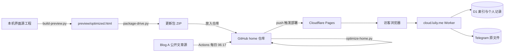

# LULIY 网站搭建、构建与维护指南

核对日期：2026-10-19。本文依据本地源码说明、`luliyer6-ux/home` 仓库现状、Cloudflare Pages 实际部署与线上检查整理。上一版（2026-10-09）的内容全部保留并补充；新增内容主要是首页优化步骤、分支预览发布、404 与重定向规则、路由说明和风险清单。

---

## 0. 一页速查

| 我要…… | 做法 | 详见 |
|---|---|---|
| 发一篇文章 | 在 Blog A（Gmeek）发布；想立即生成独立页就手动运行 Actions | 第 7 节 |
| 改首页界面 | 改本机源模块 → `build-preview.py` → `package-drive.py` → 放入 home 仓库 → `optimize-home.py` → 推分支看预览 → 合并 | 第 4、5、6 节 |
| 上线后自检 | 第 6.4 节的清单与命令 | 第 6 节 |
| 回退 | Git 回退提交，或在 Pages 部署历史里把旧部署设为正式 | 第 9 节 |
| 网盘出问题 | 查 Worker、会话、回调来源；与静态站无关 | 第 8、11 节 |
| 换电脑 | 带走源工程和**原始 HTML 快照**，修改快照路径 | 第 3、12 节 |

**三条铁律**

1. GitHub `home` 仓库里放的是**生成结果**，真正的源工程在本机。只改仓库里的 `index.html`，下次重建就会被覆盖。
2. 新的 `index.html` 放进仓库后，**必须**运行 `python3 site-publish/optimize-home.py`，否则首页会退回 2 MB 左右。
3. 推到 `main` 就会直接上线。日常改动先推到其他分支，在 Pages 预览网址确认后再合并。

---

## 1. 整体架构：四个相互独立的部分

| 部分 | 做什么 | 托管位置 | 数据来源 |
|---|---|---|---|
| 主站界面 `luliy.me` | 首页、书房、作品、文章、唱片、关于、Drive 入口与交互 | Cloudflare Pages，项目名 `home`，连接 GitHub `luliyer6-ux/home` 的 `main` 分支 | 本机生成的 HTML 与 assets |
| 公开文章发布 | 独立文章 `/articles/Pxx/`、RSS、站点地图、分享信息 | 同上，由 GitHub Actions 生成并提交 | Blog A 的公开 Gmeek 资料 |
| 私人网盘后台 `cloud.luliy.me` | Telegram 登录、文件索引、读写、收藏与个人收录 | 单独的 `tg-s3` Cloudflare Worker + D1 | 索引和记录在 D1，原文件在 Telegram |
| 外部站点 | Blog A `blog.luliy.me`、Blog B `mini.luliy.me`、部分作品页 | GitHub Pages、42web.io、`*.pages.dev` | 各自独立维护，本工程不负责重建 |

这不是“每增加一个 HTML 就租一台服务器”。Cloudflare Pages 托管静态文件，由 Cloudflare 的基础设施发送给浏览器；你没有维护任何 VPS。Worker 是单独的托管执行服务。GitHub 负责保存发布文件和版本记录。



公开网页、公开文章源和私人文件存储相互连接，但不能混在同一个文件夹里。

### 1.1 域名分工

| 地址 | 内容 | 托管 |
|---|---|---|
| `luliy.me` | 主站 | Cloudflare Pages（`home`） |
| `home-41t.pages.dev` | 同一项目的 Pages 地址；`<分支名>.home-41t.pages.dev` 是分支预览 | Cloudflare Pages |
| `cloud.luliy.me` | 私人网盘（后端 Worker：`tg-s3.luliyer6.workers.dev`） | Cloudflare Worker |
| `blog.luliy.me` | Blog A（Gmeek，仓库 `luliy6/luliy6.github.io`） | GitHub Pages |
| `mini.luliy.me` | Blog B | GitHub Pages |
| `luliy6.42web.io` | 部分作品页（CET4、Letter、408） | 42web.io 免费主机 |
| `22408-kaoyan-tools.pages.dev` | 22408 考研复习站 | Cloudflare Pages（独立项目） |

---

## 2. 前端是怎样做出来的

主站用 HTML、CSS 和 JavaScript 编写，不用 React、Vue 或 Next.js 之类的整站框架。

- **路由**：使用网址的哈希部分，例如 `#/posts`、`#/article/P54`、`#/books`、`#/music`、`#/drive`、`#/colophon`。切换栏目时，脚本只更新正文区域；导航、主题和共享播放器继续使用同一个页面环境，所以换栏目时音乐不会中断。路由的取舍见第 10 节。
- HTML 提供内容容器、导航、按钮、弹窗及可访问名称。
- CSS 控制三套主题、排版、响应式布局、焦点样式、照片光影与动画。
- JavaScript 管理路由、文章读取、目录、图箱、文件管理和播放队列。
- Canvas 与 Three.js（r185，本地打包，不依赖外部 CDN）用来绘制星空、月面、书房和唱片机。
- 音乐由**一个共享音频实例**驱动；小播放卡片和唱片页读取同一份状态，而不是各自播放一首歌。
- 文件阅读器和元数据解析组件（`assets/drive/`）按需加载，避免首次打开网站就下载全部组件或私人原文件。
- **繁简转换**：界面源文字为简体；需要繁体时，`craftsmanship` 脚本逐字查表转换，`optimize-home.py` 再补充几条词组修正（如 詞彙、乾淨、鍾情）。日文和英文界面使用各自的文案表。

**字体分工**：英文主要用 EB Garamond；中文、日文用系统衬线字体；签名用 Amalfi Coast；页名沿用现有的 Times New Roman 设置。各字体资源分别适用各自的授权条件。

**签名**不是播放视频：先从字体生成精确的字形 SVG，再准备书写轨迹；运行时用小画布逐笔描出轮廓，并缓存已经写完的字母。签名完成后，人物、门和楼梯在 y 的右下方柔和显现。开启“减少动态效果”时，直接展示完成状态。

**开场（`intro/intro.js`）**：照片墙加引言，访客点击“進入”后进入首页。

- 照片墙使用 `assets/site/prologue/` 里的 420px WebP 缩略图（共约 0.36 MB）。
- 回访访客 7 天内跳过开场；网址加 `?intro=1` 强制显示，加 `?intro=0` 强制跳过。
- 开启“减少动态效果”时不播放开场。

---

## 3. 源文件与生成结果

### 3.1 本机源工程（不在 GitHub 上）

下列路径相对于本机工程根目录。

| 文件或目录 | 用途 |
|---|---|
| `build-preview.py` | 主站生成入口，依次执行各源模块的处理 |
| `ds-v2.css`、`polish-preview.py` | 基础设计与主要界面调整 |
| `patch-galaxy.py` | 星空等视觉效果的生成处理 |
| `reader-experience.py` | 文章阅读和唱片展示 |
| `media-integration.py` | Drive、图箱、书房、唱片之间的联动 |
| `music-player.py` | 统一音乐队列和小播放卡片 |
| `site-release.py` | 发布前处理：文本、静态资源、签名、网站说明 |
| `site-colophon.js`、`site-colophon.css` | 网站说明页的内容与布局 |
| `home-signature.*`、`footer-signature.*` | 首页、页尾签名的状态和样式 |
| `signature-renderer.*`、`signature-strokes.json` | 逐笔绘制、装饰位置及预先生成的轨迹数据 |
| `brand-fonts/` | 构建时需要的字体源文件 |
| `luliy-drive*.js`、`luliy-media-library.js` | Drive、阅读器、缩略图与个人媒体联动 |
| `site-publish/generate.py` | 独立公开文章、RSS、索引的生成入口（也随 home 仓库发布） |
| `package-drive.py` | 打包正式静态发布文件，排除后台凭据 |
| `qa-*.cjs` | 浏览器验收脚本（含本机浏览器路径，换电脑需调整） |
| `tg-s3/src/`、`tg-s3/migrations/` | 私人网盘后端源码与数据库迁移，与静态主站分开 |

**本机依赖警告**：`build-preview.py` 会读取一份原始 HTML 快照，它的路径写死在脚本里，而且位于工程目录之外。换电脑时，必须带上这份快照并修改路径，或者先把它移进源工程。只下载线上 home 仓库，**不等于**拿到了完整的主站设计工程。

### 3.2 生成结果（`preview/`）

```text
preview/
  optimized.html             主站本地预览；打包后改名为 index.html
  assets/site/               图片、字体与分享图（文件名为内容摘要）
  assets/drive/              文档阅读、媒体解析等组件
  articles/P54/index.html    公开独立文章示例
  site-publish/              文章生成脚本和轻量样式
  .github/workflows/         公开文章的自动更新流程
  feed.xml / sitemap.xml / robots.txt / public-articles.json
  _headers                   静态资源缓存设置
  LULIY-建站与维护指南.md      本说明的下载文件
```

### 3.3 线上仓库 `luliyer6-ux/home`（Pages 直接发布这里的文件）

```text
index.html                   首页（经 optimize-home.py 处理后约 154 KB）
404.html                     不存在的地址显示这一页（返回 404）
favicon.ico                  网站图标
_headers                     缓存与安全响应头
_redirects                   重定向与改写规则
assets/site/                 指纹图片与字体，长期缓存
assets/site/home/            optimize-home.py 从首页拆出的 JS/CSS（内容哈希命名）
assets/site/prologue/        开场照片墙缩略图
assets/drive/                Drive 阅读与解析组件
intro/                       开场脚本、视频与海报
articles/Pxx/                独立文章静态页（Actions 生成）
site-publish/                generate.py、optimize-home.py、article.css、home-fixes.css/js
study/                       考研进度子应用（有自己的 _headers）
works/                       作品子应用：408、英语二、数学、静钟（jingzhong）、考研看板等
feed.xml / sitemap.xml / robots.txt / public-articles.json
.github/workflows/public-articles.yml
*.md                         各类说明文档（会被公开发布，可直接下载）
```

仓库根目录下的 `.md` 文件都能通过网址直接下载。不要在里面写任何密钥、Token 或私人信息。

---

## 4. 主站界面的完整构建流程（本机）

### 第一步：准备输入

准备好以下内容：原始 HTML 快照、各源模块、图片和字体、`assets/drive` 组件，以及已有的公开文章发布文件。

- Python 构建入口用 Pillow 处理图片。
- 浏览器验收另外使用 Playwright 和 Chrome；访客访问网站不需要安装这些工具。

不要把 `.env`、机器人 Token、Login Client Secret、Cloudflare 令牌或 `node_modules` 放进公开静态目录。网站只读取后台接口，不需要带着后台密钥访问。

### 第二步：修改对应的源模块

例如：改网站说明就改 `site-colophon.js`；改音乐队列就改播放器相关模块；改签名样式就改签名源文件。

**不要只改生成后的 `preview/optimized.html`**，下次重建会把它覆盖，修改就丢了。

### 第三步：执行主站生成

在工程根目录执行：

```powershell
python build-preview.py
```

处理顺序：原始 HTML → 图片压缩及基础样式 → 星空 → 界面整理 → 阅读体验 → 媒体联动 → 音乐播放器 → 发布处理。

`site-release.py` 会把部分内嵌的图片和字体拆成 `assets/site/` 下的文件，以内容摘要命名：内容相同就复用同一个文件名，内容变了就生成新文件名，方便浏览器识别更新。

不要对同一个生成文件反复单独运行各个补丁脚本：其中一些步骤按固定输入做替换，不能无限重复执行。正常更新时，从 `build-preview.py` 重新开始。

### 第四步：本机查看

可以直接打开 `preview/optimized.html` 看基本布局。更接近线上环境的做法是：

```powershell
python -m http.server 8080 --directory preview
```

然后打开 `http://localhost:8080/optimized.html#/colophon`。这只是本机的临时预览服务，关闭终端就停止。需要正式 HTTPS 来源的 Telegram 授权流程，要在正式网站上验证。

### 第五步：验收

- **界面**：桌面、手机、三套主题、键盘操作、减少动态效果、路由返回，以及图片和字体是否缺失。
- **音乐**：播放、切歌、列表，以及跨栏目连续播放。
- **Drive**：登录前为空、退出后清理、文件大小限制、预览出错时的提示。

本地工程已有 `qa-home-signature.cjs`、`qa-footer-signature.cjs`、`qa-site-release.cjs` 等检查工具，里面写着当前电脑的浏览器路径，换电脑要先调整。要分清“文章源网络故障”和“界面逻辑错误”，不能把缺失的网络内容当成通过验证。

### 第六步：打包

```powershell
python package-drive.py
```

得到 `LuliyDrive-更新包.zip`。打包时会把预览 HTML 改名为 `index.html`，同时带上资源、公开文章、自动更新脚本、索引和说明；`manifest.json` 保存文件摘要和发布标记。

打包脚本会读取本机的后端配置，检查有没有意外混入敏感值，但不会把配置文件放进 ZIP。换电脑时如果没有这份配置文件，要先调整打包检查的输入；不要为了能打包，就把密钥复制到静态网页里。

---

## 5. 首页优化：`site-publish/optimize-home.py`

生成出来的 `index.html` 把全部脚本和样式都内嵌在一个文件里，约 2 MB；Three.js、书房代码和繁简表就占了一大半。HTML 本身不能长期缓存（每次访问都要重新验证），所以老访客每次都要重新下载约 570 KB（压缩后）。

`optimize-home.py` 是**放进仓库之后**的后处理，作用如下：

1. **拆分大块内嵌资源**：`<body>` 里超过 4 KB 的内嵌脚本和主样式表（`#site-styles`）会移到 `assets/site/home/<内容哈希>.js/.css`，原位置换成外部引用，**执行顺序不变**。`<head>` 里的脚本保持内嵌，避免拖慢首屏。CSS 里的相对路径 `url(assets/...)` 会自动改成 `/assets/...`。
2. **长期缓存**：`assets/site/*` 由 `_headers` 设置为一年缓存且内容不变（immutable）。文件名就是内容哈希，内容一变文件名就变，不会读到旧缓存。
3. **注入修复文件**：在 `</head>` 前加入 `site-publish/home-fixes.css`，在 `</body>` 前加入 `home-fixes.js`（目前的作用是：手机和平板滚动后，顶栏加半透明背景）。
4. **繁简修正**：钟→鐘，补上 着→著，并修正 詞彙、字彙、語彙、乾淨、乾燥、餅乾、鍾情、鍾愛 等词组。
5. **开场脚本版本号**：按 `intro/intro.js` 的内容自动更新 `?v=`。
6. **颜色变量**：最后运行 `site-publish/color-tokens.py`（也可单独运行）。见下方 5.1。

用法：

```bash
python3 site-publish/optimize-home.py
```

- **可以重复运行**：已经处理过的首页会显示“already optimized”，仍被引用的文件不会被删除，不再引用的旧文件会被清理。
- 如果提示 `patch skipped (not found)`，说明源工程里对应的代码变了，替换规则需要更新；首页仍然能正常工作，只是那条修正没有生效。
- 实测效果（2026-10-19，桌面）：首页 HTML 压缩后从 572 KB 降到 54 KB；首次访问总传输从 3.67 MB 降到 2.33 MB；再次访问从 572 KB 降到约 54 KB。

建议以后把这一步并入本机的 `build-preview.py` 或 `package-drive.py`，从源头上避免漏跑。

### 5.1 颜色变量：`site-publish/color-tokens.css`

三套外观（深色 dark / 浅色 light / cc）的界面颜色**只在这一个文件里定义**，每套 10 个：

| 变量 | 用途 | 深色 | 浅色 | cc |
|---|---|---|---|---|
| `--bg` | 页面底色 | #111110 | #faf9f5 | #101116 |
| `--paper` | 卡片、面板 | #191918 | #f0eee7 | #1b1a1a |
| `--raised` | 弹层、浮层 | #222220 | #e9e6dd | #242320 |
| `--ink` | 标题、最深的字 | #f2ede4 | #141413 | #eadfbe |
| `--text` | 正文 | #e8e3d9 | #30302d | #d5c8a5 |
| `--muted` | 次要文字 | #a6a198 | #66645e | #b3a487 |
| `--line` | 分隔线 | #3b3935 | #d8d5cd | #494334 |
| `--line-strong` | 按钮、输入框边框 | #777168 | #918b80 | #82745c |
| `--accent` | 唯一强调色（金） | #b89a6a | #8b6840 | #d2b878 |
| `--focus-ring` | 键盘焦点框 | #b89a6a | #9b4a32 | #e9ad88 |

- 改颜色：只改 `color-tokens.css`，然后运行 `python3 site-publish/optimize-home.py`（或 `python3 site-publish/color-tokens.py`）。
- `color-tokens.py` 会把旧变量名改成上面的 10 个（`--gold`→`--accent`，`--lr-*`、`--ld-*`、`--sp-*`、`--surface-*`、`--text-*`、`--border-*`、`--control-line`、`--reading-accent`、`--rt-accent`、`--reader-heading-color` 等），删除其他地方对这些颜色的定义，把文件内嵌为 `<style id="color-tokens">`，并给改动过的缓存文件换新哈希名。可重复运行。
- 源工程重建后旧变量名会回来，跑一遍 `optimize-home.py` 即可重新收拢；长期仍建议在本机源模块里直接改用这 10 个变量。
- `--reader-body-color` 保留：阅读设置会把用户选的正文颜色写在 `<html>` 上，默认值是 `--text`。
- 场景专用颜色不进这张表：卡片烫金 `--foil-*`、首页签名金 `--signature-gold-*`、唱片封面插画、唱机材质。

---

## 6. GitHub 与 Cloudflare 怎样发布

### 6.1 发布前准备

1. 保留上一版更新包和对应的提交号，明确本次的发布范围。
2. 把新包解压到一个独立文件夹，核对 `index.html` 和资源是否齐全。
3. 把发布文件放进 home 仓库对应的根目录，保留其他仍在使用的文件（`404.html`、`favicon.ico`、`_redirects`、`works/`、`study/` 等）。
4. **运行 `python3 site-publish/optimize-home.py`。**
5. 用 `git diff --stat` 检查改动范围。

### 6.2 推荐流程：分支预览，然后合并

Cloudflare Pages 连接的是 `main`：**推到 `main` 就会立即部署上线**。推到其他分支，则会生成一个预览网址。

```bash
git checkout -b 改动名称
git add -A
git commit -m "说明这次改了什么"
git push -u origin 改动名称
```

- 几十秒后，预览出现在 `https://<分支名>.home-41t.pages.dev`。准确网址也可以在 GitHub 提交旁的 Cloudflare Pages 检查结果里看到，或在 Cloudflare 后台的 Pages 部署列表里找。
- 在预览网址上验收（见 6.4）。没问题就在 GitHub 开合并请求（Pull Request）并合并到 `main`，Pages 会自动发布到 `luliy.me`。
- 预览网址和正式站分开记住开场状态，想看开场就加 `?intro=1`。

### 6.3 发布时不要遗漏

`assets/`、`articles/`、`site-publish/`（含 `optimize-home.py`、`home-fixes.*`）、RSS 与索引、`_headers`、`_redirects`、`404.html`、`favicon.ico`、指南下载文件；自动文章更新还需要 `.github/workflows/public-articles.yml`。

不要把 `tg-s3`、整个本地工程或历史预览上传成公开静态文件。

### 6.4 上线后检查

先在 Pages 部署列表确认部署状态和对应的提交号，再访问 `https://luliy.me/`，不要只看 GitHub 是否上传成功。资源可能命中浏览器缓存，可以开新的无痕窗口或强制刷新（Mac：Cmd+Shift+R）对比。

人工检查：

- 首页、开场（`?intro=1`）、书房、作品、文章、唱片、Drive
- 桌面和手机两种尺寸；三套主题；繁体、简体、英文、日文
- 音乐播放与跨栏目连续播放；Drive 登录与退出
- 旧链接 `/article/P55` 能打开；随便输入一个不存在的地址，显示 404 页

命令检查：

```bash
curl -s -o /dev/null -w "%{http_code} %{size_download}\n" https://luliy.me/            # 200，约 15–20 万字节
curl -s -o /dev/null -w "%{http_code}\n" https://luliy.me/not-exist-xyz                # 404
curl -s -o /dev/null -w "%{http_code}\n" https://luliy.me/article/P55                  # 200
curl -sI https://luliy.me/ | grep -i strict-transport-security                         # 有 HSTS
curl -sI https://luliy.me/assets/site/home/<任一文件>.js | grep -i cache-control        # max-age=31536000, immutable
```

Pages 发布的是已经生成好的静态结果，不会自动运行你电脑上的 `build-preview.py`。如果将来想在云端重新生成整个主站，需要先把全部输入和依赖放进一个可复现的源仓库，不能让云端读取本机路径。

---

## 7. 文章怎样新增和修改

### 7.1 日常写作

在 Blog A 原来的 Gmeek 文章源里新增或编辑文章，等原博客生成完成。主站读取公开文章资料；私人 Drive 里的文件不会自动变成公开文章。

### 7.2 两种阅读网址

- `https://luliy.me/#/article/P54`：主站里的互动阅读页，带阅读功能和共享播放器。旧格式 `https://luliy.me/article/P54` 由 `_redirects` 交给首页处理，也能打开。
- `https://luliy.me/articles/P54/`：独立静态文章，实际文件是仓库里的 `articles/P54/index.html`，适合分享，也适合不运行 JavaScript 的阅读器和搜索引擎。

`P54` 是文章的身份，不能为了排序好看而重新编号。新文章用新身份，旧文章的静态地址保持不变。

### 7.3 更新独立文章、RSS 与站点地图

`site-publish/generate.py` 读取公开的 `postList.json`，筛选出有效的公开文章并读取正文。它会移除脚本、嵌入对象和事件属性等内容，重建目录、规范网址和分享信息。

这一步和界面构建是分开的：重新运行 `build-preview.py`，不会重新抓取公开文章。需要主动更新时：

```powershell
python site-publish/generate.py preview
```

或者在 home 仓库打开 **Actions → Update public articles → Run workflow → main**。

- **定时**：每天 UTC 22:17，即北京时间次日 06:17；排程时间不保证精确到秒，以实际运行记录为准。
- **只提交变化**：只有文件内容有变化才会提交。Actions 直接提交到 `main`，提交后还要等 Pages 部署完成，静态阅读页才会更新。
- **失败不覆盖**：来源读取失败或正文缺失时，生成直接失败，不会用空文章替换已有正文。脚本先在临时目录准备完整结果，再写入发布目录。
- **不会动首页**：Actions 只改 `articles/`、`feed.xml`、`sitemap.xml`、`robots.txt`、`public-articles.json`，不碰 `index.html`，和首页优化互不影响。

所以主站文章列表（浏览器实时读取公开数据）和独立文章页（依赖生成和部署）可能短时间不同步。更新文章后手动运行一次工作流程，并确认 Pages 部署完成，就能缩短这段差异。

---

## 8. Drive 后台的搭建顺序

以下说明部署步骤；本文没有重新执行部署或数据库修改。

1. 在 Telegram 准备机器人和目标存储群，按 tg-s3 项目说明配置权限和管理员。
2. 在 Cloudflare 准备 Worker 和 D1，把数据库绑定为工程要求的 `DB`。
3. 在 `tg-s3` 里安装依赖，保留原有配置。应用迁移前，先核对迁移列表、已有的表和数据库备份，只应用需要的迁移；**不能每次前端更新都重新初始化数据库**。
4. 把需要保密的值配置为后台密钥（`wrangler secret put`）。Bot Token 和 Telegram Login Client Secret 是两种不同的凭据。
5. 在 BotFather 的 OpenID Connect 设置里，登记正式网页来源和完整的回调地址；回调的路径和来源，必须和 Worker 的登录实现对应。
6. Worker 通过类型检查和测试后，按该工程的部署流程发布。前端更新和后端发布分开安排。
7. 在正式 HTTPS 网站用本人账号授权，验证管理员限制、过期和退出；再用另一台设备检查收藏、书签、阅读位置和私人收录。

**数据设计**

- D1 保存文件索引、会话和个人记录；文件身份用 `(bucket, key)` 表示；Telegram 保存原文件。
- 文件的签名下载地址有有效期，所以曲库保存的是稳定的文件身份，而不是把临时下载链接当成永久地址。
- 照片复用图箱，音乐复用共享播放器，私人书籍复用阅读器。“加入唱片／书房”只是一条收录记录，不会移动原文件。
- “移出”文件和“尝试删除 Telegram 原消息”是两种不同的操作。
- 网页上传目前限制为单文件 20 MB；浏览器支持哪些编码，也会影响能否播放或预览。

更详细的使用和配置，见仓库里的 `LuliyDrive 使用说明书.md`、`LuliyDrive 登录配置.md`、`LuliyDrive 联动后台迁移说明.md`、`LuliyDrive 更新与验收.md`。

---

## 9. 缓存、安全头、重定向与回退

### 9.1 `_headers`

| 路径 | 设置 | 原因 |
|---|---|---|
| `/*` | `Strict-Transport-Security: max-age=31536000` | 浏览器以后只走 HTTPS |
| `/assets/site/*` | 缓存一年，内容不变（immutable） | 文件名就是内容哈希 |
| `/feed.xml`、`/site-publish/article.css`、`/404.html` | 缓存 5 分钟 | 偶尔更新 |
| `/favicon.ico` | 缓存 7 天 | 很少更新 |
| 其他（含 `index.html`） | Pages 默认：每次向服务器确认 | 保证改动立即可见 |

**规则**：`assets/site/` 里只放“内容变了文件名也变”的文件。**不要用同名文件替换旧图**，老访客会继续看到缓存里的旧图，最长一年。

### 9.2 `_redirects` 与 404

- 仓库根目录有 `404.html`，所以 Pages **不再把所有地址都当作首页**：不存在的地址会返回 404 状态码和这一页。
- 需要交给首页路由的路径，必须写成改写规则（状态码 200），目前有：

  ```text
  /article/* / 200
  /post/* / 200
  ```

- 已下线的英语阅读页，用 302 跳转到 `/#/projects`。
- 新增任何“由首页处理的路径”时，都要在这里加一条，否则访问那个路径会显示 404。

### 9.3 回退

- **前端**：用 `git revert <提交号>` 回退并推送；或者在 Cloudflare Pages 部署历史里，选旧部署设为正式版本（Rollback），这样最快。
- **数据库**不属于前端：回退 HTML 不会回退 D1；涉及迁移时，要另外安排数据库备份和恢复。

---

## 10. 关于 `#/` 路由

当前栏目使用 `#/` 路由，例如 `luliy.me/#/posts`。

**优点**

- 网址 `#` 后面的部分不会发给服务器，任何栏目刷新都能打开，不需要服务器额外配置。
- 本机直接打开 HTML 文件也能使用。

**缺点**

- 搜索引擎把所有栏目都当作首页，书房、唱片、作品等栏目无法单独收录。
- 分享时，聊天软件抓到的永远是首页的标题和图片；文章的分享按钮会改用 `/articles/Pxx/`，就是为了绕开这一点。
- 和页内锚点（跳到正文、文章目录）共用 `#`，需要专门处理冲突。
- 访问统计按路径计算，各栏目都会被算作首页。

**改成普通路径（如 `/posts`）的代价**

- 源码中约 39 处读取 `location.hash`、9 处监听 `hashchange`、35 处生成链接，以及开场、Drive、目录弹窗都要改，并统一拦截站内链接和处理前进后退。
- 每个栏目都要在 `_redirects` 里加改写规则，否则刷新就是 404。
- 资源路径要全部改成以 `/` 开头的绝对路径。
- 旧的 `#/…` 链接要在首页脚本里自动转换成新路径，否则旧书签和已经分享出去的链接会失效。
- 只换网址不会自动带来收录：栏目内容仍由 JS 生成。想被收录、分享时有自己的卡片，还要像 `/articles/` 那样，给各栏目预先生成静态 HTML 和分享信息。

**结论**：要改，就在本机源工程里一次性完成，不要在生成结果上改。如果只是想让文章被收录、分享好看，现在的 `/articles/` 静态页已经够用。

---

## 11. 费用、资源和备份

- 没有新增 VPS 或付费转换服务。R2 持久缓存在当前 `wrangler.toml` 中没有启用：关闭它不会删除 Telegram 原文件，但再次读取文件可能要重新经过 Worker 和 Telegram。
- “按免费额度设计”不等于永久无限，也不包括域名续费。Pages、Worker、D1、GitHub Actions 各有自己的计划和额度，是否产生费用取决于账户计划和实际用量。额度不够时应明确处理，不会自动升级为付费方案。
- 公开静态资源都有网址，例如 `/assets/site/…`、`/assets/drive/…`，但它们不等于私人 Drive 里的原文件。旧版本资源可能为了回退而保留，清理前要确认当前页面或旧部署是否仍在引用。

**备份要分五类，各管各的**

| 类别 | 现状 | 建议 |
|---|---|---|
| 主站源工程 + 原始 HTML 快照 | **只在本机** | 建一个私有 GitHub 仓库存放（最重要） |
| 公开发布仓库 `home` | GitHub 自带版本历史 | 无需额外操作 |
| 公开文章源（Blog A） | GitHub | 无需额外操作 |
| D1 记录 | Cloudflare | 定期运行 `wrangler d1 export` 导出 |
| 重要的 Telegram 原文件 | Telegram | 重要文件另存一份 |

只备份 ZIP，不一定保留了完整的界面源工程；只备份 GitHub，也不包括私人网盘里的全部原文件。

---

## 12. 常见维护问题

| 现象 | 先检查什么 |
|---|---|
| 首页又变成 2 MB 左右，变慢 | 发布前漏跑了 `optimize-home.py` |
| 字体变了、图片缺失 | HTML 引用的指纹文件是否存在；`assets/` 是否完整上传；字体是否真的加载成功 |
| `assets/site/home/*.js` 返回 404 | `optimize-home.py` 生成的文件没有一起提交 |
| 某个旧地址变成 404 | 是否需要在 `_redirects` 里加改写规则 |
| 改了开场看不到效果 | 7 天内不会再显示开场；用 `?intro=1` |
| 运行优化脚本时提示 `patch skipped` | 源工程里对应的代码变了，需要更新脚本里的 `PATCHES` |
| DOCX、PDF 等阅读组件加载失败 | `assets/drive` 是否漏传；请求是否返回 404 或 HTML 错误页 |
| 原博客已更新，独立文章还是旧的 | Actions 是否运行成功；对应的 Pages 部署是否完成 |
| 网页能打开，但私人网盘打不开 | Worker、登录会话、来源配置和文件读取错误；不能只查静态仓库 |
| 换电脑后无法生成界面 | 原始 HTML 快照、源模块、字体、组件和构建依赖是否齐全；快照路径是否已改 |
| 音乐列表不同步 | 各个点歌入口是否都用共享队列；文件身份、来源和当前曲目是否一致 |
| 页尾动画卡顿 | 局部绘制和离屏停止是否生效；在同一浏览器里分别测签名和背景粒子的开销 |
| 手机顶栏压住内容 | `home-fixes.css/js` 是否已注入（查看首页源码里的 `data-home-fixes`） |

---

## 13. 已知风险与待办（按优先级）

1. **源工程只在本机**：把源工程和原始快照放进私有 GitHub 仓库；之后可以让 Actions 在云端自动跑“生成 → 优化 → 发布”。
2. **把优化步骤并入构建**：把 `optimize-home.py` 并入 `package-drive.py`，或者把它的拆分逻辑写进 `site-release.py`，避免漏跑。
3. **Three.js 等大脚本仍在首页启动时加载**：在源工程里改成需要时再加载（唱片区进入视野、打开书房时），首次访问还能再省约 0.6 MB。
4. **文章封面图偏大**（2000px 以上的 PNG，存放在博客仓库和网盘）：在源头转成 WebP 并控制尺寸。
5. **`works/jingzhong/_worker.js`**：Pages 只执行站点根目录的 `_worker.js`，子目录里的这个文件只是公开的静态文件，不会运行（已检查，文件里没有密钥）。如果静钟的 Telegram 备份依赖它，要实测一次备份；不能用的话，就单独部署成 Pages 项目或 Worker。
6. **CET4、Letter、408 托管在 42web.io 免费主机上**：这类主机可能插广告或停用，建议迁到 GitHub Pages 或 Cloudflare Pages。
7. **文案待你决定**：“Latter”（是否应为 Letter）、文章中的“走途無路”、“Blog A/B”的命名、开场角落的“2400K”。
8. **授权管理**：临时授权给工具或他人的 GitHub 权限，用完后到 GitHub **Settings → Applications** 撤销。

---

## 14. 官方资料

- [Cloudflare Pages Git 集成与构建设置](https://developers.cloudflare.com/pages/get-started/git-integration/)：提交如何触发部署。
- [Cloudflare Pages 预览部署](https://developers.cloudflare.com/pages/configuration/preview-deployments/)：分支预览网址。
- [Cloudflare Pages `_headers`](https://developers.cloudflare.com/pages/configuration/headers/) 与 [`_redirects`](https://developers.cloudflare.com/pages/configuration/redirects/)：响应头、重定向与改写。
- [Cloudflare Pages 404 与单页应用行为](https://developers.cloudflare.com/pages/configuration/serving-pages/)：有没有 `404.html` 时的区别。
- [Cloudflare Pages 回退部署](https://developers.cloudflare.com/pages/configuration/rollbacks/)
- [GitHub 手动运行工作流程](https://docs.github.com/en/actions/how-tos/manage-workflow-runs/manually-run-a-workflow)：Run workflow 的使用条件。
- [Cloudflare Pages 平台限制](https://developers.cloudflare.com/pages/platform/limits/)：发布文件和部署额度以当前计划为准。
- [Cloudflare Workers 定价](https://developers.cloudflare.com/workers/platform/pricing/)与 [D1 定价](https://developers.cloudflare.com/d1/platform/pricing/)：核对当前后台额度。

网站说明的入口在主站页尾的“網站說明”（`#/colophon`），该页面保留了既有的图像来源和月面资料署名。本站展示文章、字体或音频，不改变原作者和素材的权利归属。
